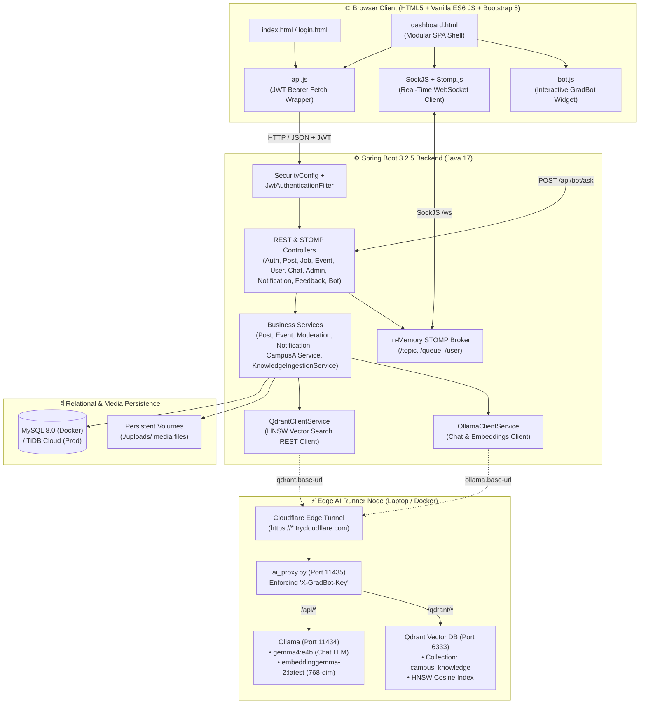

# 🎓 Campus Connect

> 🌐 **Live Production URL:** [**https://campus-connect-live.onrender.com**](https://campus-connect-live.onrender.com)

[](https://campus-connect-live.onrender.com)
[](https://adoptium.net/)
[](https://spring.io/projects/spring-boot)
[](https://www.mysql.com/)
[](https://qdrant.tech/)
[-10b981?style=for-the-badge&logo=ollama&logoColor=white)](https://ollama.com/)
[](docker-compose.yml)

A unified, real-time campus networking and AI intelligence platform designed for **BVICAM (Bharati Vidyapeeth's Institute of Computer Applications and Management)**. Campus Connect bridges the communication gap between **students**, **alumni**, and **college administration**, combining real-time messaging, bilingual content moderation, event management, and career referrals with **GradBot**—a privacy-preserving, RAG-powered AI campus assistant backed by **Google Gemma 4**, **Gemma 2 Embeddings**, and **Qdrant Vector Database**.

---

## 📚 Project Documentation (`docs/`)

Comprehensive architectural, dataflow, database, and codebase guides are located in the [`docs/`](docs/README.md) directory. Every guide includes **GitHub-native Mermaid diagrams** that render directly on GitHub:

| Document | Description |
| :--- | :--- |
| 📖 **[Documentation Hub (`docs/README.md`)](docs/README.md)** | Overview of all technical documentation, quick start links, and navigation index |
| 🏗️ **[System Architecture (`docs/architecture.md`)](docs/architecture.md)** | 5-layer backend architecture, JWT security filter chain, STOMP WebSocket topology, and Docker/Render deployment |
| 📁 **[Codebase Directory & API Reference (`docs/codebase-directory.md`)](docs/codebase-directory.md)** | Complete annotated file tree, package-by-package guide, and full REST & WebSocket endpoint reference tables |
| 🔄 **[End-to-End Data Flows (`docs/dataflow.md`)](docs/dataflow.md)** | Step-by-step sequence and flowchart diagrams for Auth, Wall Moderation, 1-on-1 Chat, Directory Search, Events RSVP, and Jobs |
| 🗄️ **[Database Schema (`docs/database-schema.md`)](docs/database-schema.md)** | Complete Entity-Relationship (`erDiagram`) visual and column-by-column specifications for all relational tables |
| ✨ **[Features & Role Matrix (`docs/features.md`)](docs/features.md)** | Role-Based Access Control (`STUDENT` / `ALUMNI` / `ADMIN`) matrix and deep dive into all platform modules |
| 🎯 **[Interview Guide & Q&A (`docs/interview-guide.md`)](docs/interview-guide.md)** | 30-second elevator pitch, 3-minute structured walkthrough script, and technical interview questions & model answers |
| 🏛️ **[ADR-001: AI Chatbot & RAG Engine (`docs/adr/ADR-001-ai-chatbot-rag-knowledge-engine.md`)](docs/adr/ADR-001-ai-chatbot-rag-knowledge-engine.md)** | Architecture Decision Record for local Ollama `gemma4:e4b` integration, RAG knowledge store, and Admin ingestion |
| 🎟️ **[AI Vertical-Slice Tickets (`docs/tickets/ai-chatbot-vertical-slices.md`)](docs/tickets/ai-chatbot-vertical-slices.md)** | Vertical slice breakdown (CC-AI-01 through CC-AI-06) for AI chatbot integration |
| 📋 **[Formal Specification: GradBot AI (`docs/specs/ai-chatbot-rag-engine.spec.md`)](docs/specs/ai-chatbot-rag-engine.spec.md)** | Formal engineering specification covering Problem, Solution, User Stories, Architecture, and Testing |
| 💻 **[Hybrid AI Runner Guide (`docs/guides/local-ai-runner-guide.md`)](docs/guides/local-ai-runner-guide.md)** | Guide for running Gemma 4, Gemma 2 Embeddings, and Qdrant locally on any laptop and tunneling to Render |

---

## 🏛️ System Architecture



---

## 🎯 Aim & Core Objectives

Campus Connect replaces fragmented third-party messaging apps with a unified, secure academic hub where:
- **Students** apply for jobs and referrals, RSVP to campus events, network with alumni, and ask **GradBot** questions about syllabus, faculty, and notices.
- **Alumni** publish job openings and referral opportunities, mentor students, and stay connected with college initiatives.
- **Administrators** moderate content, bulk-onboard users via Excel/CSV, broadcast announcements, and ingest campus circulars and PDFs into GradBot's RAG vector database.

---

## ✨ Key Platform Features

### 1. 🤖 GradBot AI Campus Assistant & Hybrid RAG Engine
- **Local LLM Inference (`gemma4:e4b`):** 100% private, zero-subscription-cost AI assistant running on edge hardware, generating natural language answers grounded in verified campus facts.
- **Dense Vector Search (`embeddinggemma-2:latest`):** Vectorizes notices and web documents into **768-dimensional embeddings** using Google's modern embedding model.
- **Qdrant Vector Database:** High-performance **HNSW vector indexing** and Cosine distance retrieval in the dedicated `campus_knowledge` collection.
- **Unified Tunnel & Proxy Multiplexing:** Exposes both Ollama and Qdrant through the **exact same Cloudflare Tunnel** and authentication proxy (`scripts/ai_proxy.py`) secured by the `X-GradBot-Key` header.
- **Admin Document Ingestion:** Upload notice PDFs (via **Apache PDFBox**) or crawl `bvicam.in` URLs (via **Jsoup**). Chunks are automatically embedded, written to MySQL, and indexed into Qdrant.
- **Resilient Circuit Breaker Fallback:** If edge hardware is offline, GradBot automatically falls back to database cosine similarity and live MySQL domain data without crashing.

### 2. 🔐 Authentication & Role-Based Access Control
- **Stateless JWT Security:** HMAC-SHA256 signed JSON Web Tokens (`24h` validity) evaluated by `JwtAuthenticationFilter`.
- **Role Hierarchy:** Distinct privilege boundaries for `ADMIN`, `ALUMNI`, and `STUDENT`.
- **Bulk Excel/CSV Onboarding:** Admins can onboard hundreds of users in seconds via `.xlsx` or `.csv` files using Apache POI.

### 3. 🧱 Campus Wall & Automated Moderation
- **Social Feed:** Posts with text and up to 4 file attachments (`10 MB` max), likes, and threaded discussions.
- **Automated Bilingual Filter:** Real-time profanity screening in English and Hindi/Hinglish. Repeated strikes trigger warnings (`1–2 strikes`), a `24-hour` ban (`3–4 strikes`), or a `7-day` suspension (`5+ strikes`).

### 4. 💬 Real-Time Chat (STOMP WebSockets)
- **Global Campus Lounge:** Broadcast channel (`/topic/public`) for college-wide discussions.
- **1-on-1 Direct Messaging:** Private messaging (`/user/{username}/queue/messages`) with live typing indicators, unread counters, and persistent chat history.

### 5. 💼 Jobs, Referrals & Events
- **Jobs & Referrals:** Publish and browse career opportunities with salary package, application links, and company details.
- **Event Management & RSVP:** Seminars, hackathons, and workshops with 1-click RSVP and attendee rosters.

---

## 🛠️ Technology Stack

| Layer | Technologies |
| :--- | :--- |
| **Backend** | Java 17, Spring Boot 3.2.5, Spring Security 6, Spring Data JPA (Hibernate), Spring WebSocket (STOMP + SockJS), JJWT `0.11.5`, Apache POI `5.2.5`, Apache PDFBox `3.0.3`, Jsoup `1.18.3`, Jackson Databind, Lombok |
| **Vector DB** | **Qdrant** (HNSW Vector Index, 768 dimensions, Cosine metric, `campus_knowledge` collection) |
| **AI Models** | **Ollama** Runtime, Chat LLM: `gemma4:e4b` (6.6 GB), Embedding Model: `embeddinggemma-2:latest` (768 dimensions) |
| **Edge Tunnel** | Ephemeral **Cloudflare Tunnel** (`*.trycloudflare.com`), Python HTTP reverse proxy (`ai_proxy.py` on port 11435) with `X-GradBot-Key` shared-secret auth |
| **Frontend** | HTML5, Modern CSS3 Design Tokens, Vanilla JavaScript (ES6+ Modules), Bootstrap 5.3, Bootstrap Icons, DOMPurify 3.0.9, SockJS, Stomp.js |
| **Databases** | MySQL 8.0 (Local & Docker) / TiDB Cloud Serverless (Production) / H2 Embedded (Local Dev Profile) |
| **Containers** | Multi-stage [`Dockerfile`](Dockerfile), [`docker-compose.yml`](docker-compose.yml), [`docker-compose.ai-runner.yml`](docker-compose.ai-runner.yml) |

---

## 🚀 Setup & Execution Guide

Campus Connect provides flexible setup modes for any environment:

### Mode 1: Full-Stack Docker Compose (Recommended for Complete Local App)
Runs **Spring Boot**, **MySQL 8.0**, and **Qdrant Vector Database** together in isolated containers:

```bash
# Build and start all services in the background
docker compose up --build -d

# Check service logs
docker compose logs -f app

# Stop all containers (preserves database & vector data volumes)
docker compose down
```

- **Web Application:** `http://localhost:8080`
- **Qdrant Vector Engine:** `http://localhost:6333`
- **MySQL Database:** `localhost:3307` (internal `3306`)

---

### Mode 2: Portable Docker AI Runner (For ANY Laptop: Mac, Windows, Linux)
Allows you to run the **AI Edge Node** (Ollama + Qdrant + Multiplexed Proxy + Cloudflare Tunnel) on **any laptop** to power the live Render cloud deployment with zero manual dependency installation:

#### On macOS or Linux:
```bash
./start-ai-runner-docker.sh
```

#### On Windows (Command Prompt or PowerShell):
```cmd
start-ai-runner-docker.bat
```
*(Or execute: `docker compose -f docker-compose.ai-runner.yml up -d`)*

**What this script does automatically:**
1. Checks Docker Engine readiness.
2. Loads or generates a 48-character secret token in `.env.ai-runner`.
3. Starts containers: `campus-ai-qdrant`, `campus-ai-ollama`, `campus-ai-proxy`, and `campus-ai-tunnel`.
4. Automatically pulls `embeddinggemma-2:latest` and `gemma4:e4b` into the Ollama container.
5. Captures the public Cloudflare Tunnel URL and prints the exact Render configuration instructions.

---

### Mode 3: Native Mac AI Runner (Apple Silicon GPU Acceleration)
For Apple Silicon Macs (`M1/M2/M3/M4`), this mode leverages your Mac's unified memory for blazing-fast native GPU inference:

```bash
./start-ai-runner.sh
```

**What this script does automatically:**
1. Verifies local `ollama` daemon and pulls models if missing.
2. Detects architecture and runs standalone `bin/qdrant` on port `6333`.
3. Starts the authenticated Python proxy on port `11435`.
4. Creates the Cloudflare Tunnel and prints the connection details.

---

### Mode 4: Local Native Development (Spring Boot + Embedded Database)
Runs the Spring Boot server locally with an embedded, persistent H2 database in MySQL mode (zero external database installation needed):

```bash
./run-local.sh
```
*(Or: `./mvnw spring-boot:run -Dspring-boot.run.profiles=local`)*

---

## ☁️ Connecting Local AI Runner to Render Production

When running the AI Runner on your laptop (via Mode 2 or Mode 3), connect your live Render deployment to your laptop edge node:

1. Log in to [**Render Dashboard**](https://dashboard.render.com).
2. Open your **Campus Connect** Web Service -> click the **Environment** tab.
3. Update or add these environment variables:

| Variable | Value | Purpose |
| :--- | :--- | :--- |
| `OLLAMA_BASE_URL` | `https://<tunnel-subdomain>.trycloudflare.com` | Public Cloudflare tunnel URL from the runner output |
| `OLLAMA_AUTH_TOKEN` | `<your-token-from-.env.ai-runner>` | Shared secret token enforcing zero-trust access control |
| `OLLAMA_AUTH_HEADER` | `X-GradBot-Key` | Authentication header sent from Render to your proxy |

> [!TIP]
> **Zero Extra Variables for Qdrant:**
> Render automatically derives `qdrant.base-url` from `${ollama.base-url}/qdrant`. The multiplexer proxy receives requests at `/qdrant/*` and forwards them internally to Qdrant on port 6333 behind the exact same `X-GradBot-Key` authentication!

---

## 🧪 Verification & Diagnostic Commands

### 1. Test Suite Execution
Execute the comprehensive JUnit 5 and Mockito test suite:
```bash
./mvnw test
```
*Current test status: **39 tests passed, 0 failures, 0 errors**.*

### 2. Verify AI Proxy Health
```bash
# Test health endpoint through Cloudflare Tunnel (no secret required for health)
curl -s https://<tunnel-subdomain>.trycloudflare.com/health
```
Expected response:
```json
{
  "status": "ONLINE",
  "service": "GradBot-AI-Secure-Proxy",
  "ollama": "ONLINE",
  "qdrant": "ONLINE",
  "timestamp": "2026-10-29T00:50:00.000000"
}
```

### 3. Verify Render GradBot Status
```bash
# Inspect live bot health via JWT bearer token
curl -s -H "Authorization: Bearer <your-jwt>" https://campus-connect-live.onrender.com/api/bot/health
```
Expected response:
```json
{
  "status": "ONLINE",
  "model": "gemma4:e4b",
  "embeddingModel": "embeddinggemma-2:latest",
  "vectorDb": "Qdrant (HNSW Vector Engine)",
  "vectorDbStatus": "ONLINE",
  "mode": "Mac AI Runner Connected (gemma4:e4b + Qdrant)"
}
```

---

## 🔑 Default Seeded Accounts

On startup, [`DataSeeder`](src/main/java/com/bvicam/campusconnect/config/DataSeeder.java) automatically seeds demo accounts:

| Role | Email | Password | Privileges |
| :--- | :--- | :--- | :--- |
| **Admin** | `admin@bvicam.in` | `admin123` | Full user CRUD, bulk onboarding, post moderation, event/job posting, document ingestion, broadcasts |
| **Alumni** | `alumni@bvicam.in` | `1234` | Post & edit jobs/referrals, directory search, wall posts, event RSVP, 1-on-1 & lounge chat |
| **Student** | `student@bvicam.in` | `1234` | Apply to jobs/referrals, directory search, wall posts, event RSVP, ask GradBot, 1-on-1 & lounge chat |
