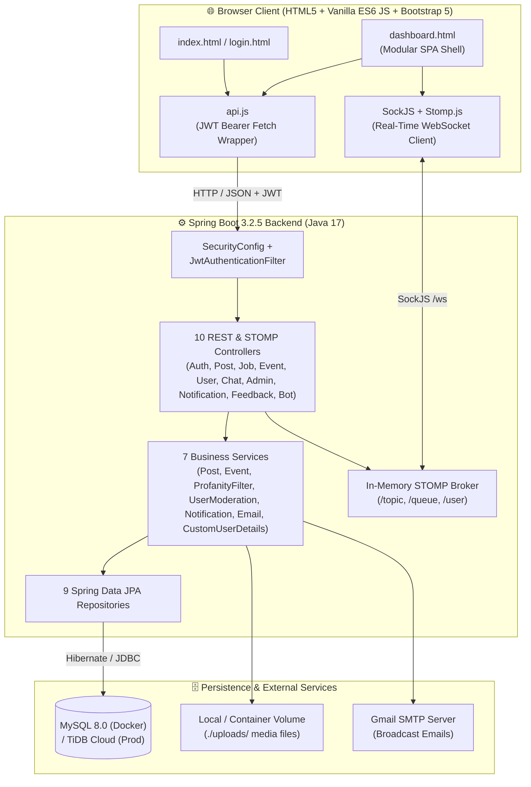

# 🎓 Campus Connect

> 🌐 **Live Production URL:** [**https://campus-connect-live.onrender.com**](https://campus-connect-live.onrender.com)

[](https://campus-connect-live.onrender.com)
[](https://adoptium.net/)
[](https://spring.io/projects/spring-boot)
[](https://www.mysql.com/)
[](docker-compose.yml)

A unified, real-time campus networking platform designed for **BVICAM (Bharati Vidyapeeth's Institute of Computer Applications and Management)** to bridge the communication gap between **students**, **alumni**, and **college administration**. Built with **Spring Boot 3.2.5**, **Spring Security (JWT)**, **Spring Data JPA**, and **STOMP over SockJS WebSockets**, this platform fosters a thriving academic community through real-time chat, bilingual content moderation, event management, and career referrals.

---

## 📚 Project Documentation (`docs/`)

Comprehensive architectural, dataflow, database, and codebase guides are located in the [`docs/`](docs/README.md) directory. Every guide includes **GitHub-native Mermaid diagrams** that render directly on GitHub:

| Document | Description |
| :--- | :--- |
| 📖 **[Documentation Hub (`docs/README.md`)](docs/README.md)** | Overview of all technical documentation, quick start links, and navigation index |
| 🏗️ **[System Architecture (`docs/architecture.md`)](docs/architecture.md)** | 5-layer backend architecture, JWT security filter chain, STOMP WebSocket topology, SPA modal hoisting, and Docker/Render deployment |
| 📁 **[Codebase Directory & API Reference (`docs/codebase-directory.md`)](docs/codebase-directory.md)** | Complete annotated file tree (88 files), package-by-package guide, and full REST & WebSocket endpoint reference tables |
| 🔄 **[End-to-End Data Flows (`docs/dataflow.md`)](docs/dataflow.md)** | Step-by-step sequence and flowchart diagrams for Auth, Wall Moderation, 1-on-1 Chat, Directory Search, Events RSVP, Jobs/Referrals, and Admin Bulk Upload |
| 🗄️ **[Database Schema (`docs/database-schema.md`)](docs/database-schema.md)** | Complete Entity-Relationship (`erDiagram`) visual and column-by-column specifications for all 11 relational tables |
| ✨ **[Features & Role Matrix (`docs/features.md`)](docs/features.md)** | Role-Based Access Control (`STUDENT` / `ALUMNI` / `ADMIN`) matrix and deep dive into all 9 platform modules |
| 🎯 **[Interview Guide & Q&A (`docs/interview-guide.md`)](docs/interview-guide.md)** | 30-second elevator pitch, 3-minute structured walkthrough script, and technical interview questions & model answers |


---

## 🏛️ High-Level Architecture Overview



---

## 🎯 Aim & Objective
The primary aim of Campus Connect is to provide an exclusive, secure, and centralized digital ecosystem for the college community. It eliminates the reliance on fragmented third-party social apps by offering a dedicated space where:

- **Students** can seek guidance, apply for jobs and referrals, RSVP to campus events, and network with seniors.
- **Alumni** can give back by posting job openings and referral opportunities, sharing industry insights, and mentoring students.
- **Administrators** can manage users (single or bulk `.xlsx`/`.csv` onboarding), moderate posts, manage events & career listings, and broadcast announcements.

---

## ✨ Key Features

### 1. 🔐 Authentication & Role Management
- **Stateless JWT Security:** HMAC-SHA256 signed JSON Web Tokens (`24h` validity) validated via `JwtAuthenticationFilter`.
- **Role-Based Access Control (RBAC):** Distinct privileges for `ADMIN`, `ALUMNI`, and `STUDENT`.
- **Single & Bulk Onboarding:** Admins can create/edit individual users or bulk-upload hundreds of student/alumni accounts via Excel (`.xlsx`/`.xls`) or `.csv` files using Apache POI.

### 2. 🧱 Campus Wall & Automated Bilingual Moderation
- **Rich Social Feed:** Create posts with text and up to 4 file attachments (`10 MB` max), like posts, and participate in threaded discussions.
- **Automated Profanity & Strike Engine:** `ProfanityFilterService` scans posts and comments against English and Hindi/Hinglish word lists using normalized regex matching. Repeated violations trigger automated warnings (`1–2 strikes`), a `24-hour` temporary ban (`3–4 strikes`), or a `7-day` suspension (`5+ strikes`) via `UserModerationService`.

### 3. 💬 Real-Time Communication (STOMP WebSockets)
- **Global Campus Lounge:** A live campus-wide chat room (`/topic/public`) for general discussions.
- **1-on-1 Direct Messaging:** Private messaging (`/user/{username}/queue/messages`) with live typing indicators, unread badge counters, read receipts (`READ` status), and persistent chat history.

### 4. 💼 Jobs & Referrals Board
- **Alumni & Admin Publishing:** Alumni and Admins can post, edit, and delete **Job Openings** (`JOB`) and **Referral Opportunities** (`REFERRAL`) with role, company, location, salary package, and application links/emails.
- **Admin Workspace Integration:** Admins also have a dedicated **Post Job / Referral** action and management table inside the Admin Portal.

### 5. 📅 Event Management & RSVP
- **Event Dashboard & Filtering:** Browse upcoming seminars, hackathons, workshops, and alumni meets with search and type filters.
- **One-Click RSVP:** Instant attendance confirmation with live participant counts.
- **Admin Controls:** Create, edit, and delete events, plus inspect the full list of registered participants (name, email, role, batch).

### 6. 🤝 Directory, Notifications, Feedback & Help Bot
- **Student & Alumni Directory:** Multi-criteria search across name/email, role (`STUDENT`/`ALUMNI`), department (`MCA`, `BJMC`, etc.), and batch year, with direct 1-click chat launch.
- **Real-Time Notification Center:** Unread badge counter and dropdown panel for likes, comments, job posts, and admin broadcasts.
- **Student Feedback & Campus Bot:** Direct feedback channel to administration (`1–5` star ratings) and a built-in floating FAQ assistant (`BotController`).

---

## 🛠️ Technology Stack

| Layer | Technologies |
| :--- | :--- |
| **Backend** | Java 17, Spring Boot 3.2.5, Spring Security 6, Spring Data JPA (Hibernate), Spring WebSocket (STOMP + SockJS), Spring Mail, JJWT `0.11.5`, Apache POI `5.2.5`, Lombok |
| **Frontend** | HTML5, CSS3 (Custom Design System), Vanilla JavaScript (ES6+), Bootstrap 5.3, Bootstrap Icons, SockJS Client, Stomp.js |
| **Database** | MySQL 8.0 (Local & Docker Compose) / TiDB Cloud Serverless (Production) |
| **Deployment** | Multi-stage [`Dockerfile`](Dockerfile), [`docker-compose.yml`](docker-compose.yml), Render Cloud ([https://campus-connect-live.onrender.com](https://campus-connect-live.onrender.com)) |

---

## 🚀 Setup & Installation

### Option 1: Docker Compose (Recommended — Zero Local Dependencies)
The project includes an isolated multi-container Docker setup ([`Dockerfile`](Dockerfile) + [`docker-compose.yml`](docker-compose.yml)) that bundles **Eclipse Temurin JDK 17**, **Maven 3.9**, and **MySQL 8.0** so nothing needs to be installed on your host machine.

```bash
# Build and start both MySQL and the Spring Boot application in the background
docker compose up --build -d

# Tail application logs
docker compose logs -f app

# Stop containers (preserving database volume)
docker compose down
```

- **Local Web App URL:** `http://localhost:8080`
- **Production Live URL:** [`https://campus-connect-live.onrender.com`](https://campus-connect-live.onrender.com)
- **Isolated Containers:**
  - `campus-connect-app` — Spring Boot 3.2.5 + JDK 17 (`localhost:8080 -> 8080`)
  - `campus-connect-mysql` — MySQL 8.0 (`localhost:3307 -> 3306`, persistent volume `campus_mysql_data`)

### Option 2: Local Native Setup
#### Prerequisites
- Java Development Kit (JDK) 17
- Maven 3.8+
- MySQL Server 8.0+

```bash
# Run with Maven Wrapper
./mvnw spring-boot:run
```

---

## 🔑 Default Seeded Accounts
On first startup, [`DataSeeder`](src/main/java/com/bvicam/campusconnect/config/DataSeeder.java) automatically seeds the database with default departments (`MCA`, `BJMC`) and demo accounts:

| Role | Email | Password | Capabilities |
| :--- | :--- | :--- | :--- |
| **Admin** | `admin@bvicam.in` | `admin123` | Full user CRUD, bulk `.xlsx`/`.csv` onboarding, post moderation, event creation/editing, job/referral posting & editing, email broadcast, feedback review |
| **Alumni** | `alumni@bvicam.in` | `1234` | Post & edit own jobs/referrals, directory search, wall posts, event RSVP, global & 1-on-1 chat |
| **Student** | `student@bvicam.in` | `1234` | Browse & apply to jobs/referrals, directory search, wall posts, event RSVP, global & 1-on-1 chat |
