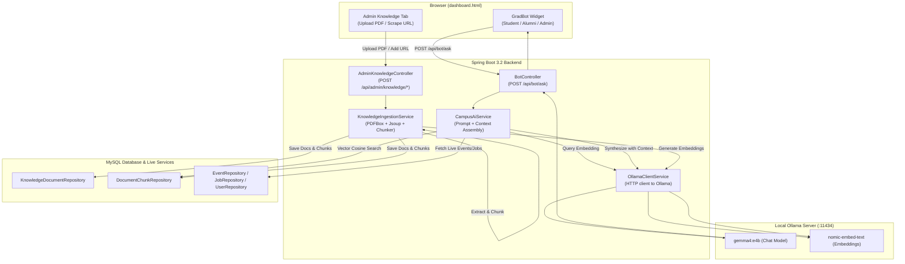

# 🏛️ Architecture Decision Record (ADR-001)

## Status: ACCEPTED
**Date:** 2026-10-27  
**Decision Makers:** Campus Connect Core Team & System Architecture  
**Context:** Adding an AI Chatbot for BVICAM (GradLink) capable of answering questions from official BVICAM web pages, GradLink internal live entities (Events, Jobs, Alumni), and Admin-uploaded documents (Notices, Circulars, PDFs).

---

## 1. Context and Problem Statement

GradLink (Campus Connect) currently has a basic rule-based FAQ bot in `BotController.java` (`POST /api/bot/ask`) that matches hardcoded strings against student questions. This approach has critical limitations:
1. It cannot answer arbitrary student, alumni, or admin queries regarding college regulations, examination circulars, admission procedures, or syllabus details.
2. It has no mechanism for administrators to upload new notices or circulars and have the bot immediately know about them.
3. It cannot synthesize answers from the official **BVICAM website (`bvicam.in`)**.
4. It lacks modern conversational capability, contextual synthesis, and source citations.

The team requires an **AI-powered Chatbot Assistant** that:
- Answers queries across 3 key knowledge layers: (1) BVICAM official website pages, (2) Admin-uploaded documents/notices, and (3) Live GradLink database entities (Events, Jobs, Alumni Directory).
- Accessible to all authenticated roles (`STUDENT`, `ALUMNI`, `ADMIN`).
- Powered by a local **Ollama** runtime hosting the **`gemma4:e4b`** model on Mac / local development with configurable fallback.
- Empowers administrators to manage the knowledge base (upload PDFs/text notices, scrape/index BVICAM URLs, and delete outdated documents) directly from the Admin Workspace.

---

## 2. Decision

We will implement a **Hybrid Retrieval-Augmented Generation (RAG) & Dynamic Database Context Engine** integrated directly into the Spring Boot 3.2 backend, paired with local **Ollama (`gemma4:e4b`)** inference:

### A. Inference Engine
- **Primary LLM:** Local **Ollama** server running at `http://localhost:11434` with `gemma4:e4b` (6.6 GB model optimized for Apple Silicon and low latency).
- **Embedding Model:** Local Ollama `nomic-embed-text` (or `all-minilm`) for 768-dimensional / 384-dimensional dense vector embeddings.
- **Configurability:** All endpoints and model names parameterized in `application.properties` with fallback behavior if Ollama is unreachable.

### B. Domain Models & Relational Storage
- We introduce two new JPA entities in `com.bvicam.campusconnect.entity`:
  1. `KnowledgeDocument`: Stores metadata (`title`, `category`, `sourceType`, `sourceUrl`, `originalFileName`, `chunkCount`, `uploadedBy`, `createdAt`).
  2. `DocumentChunk`: Stores chunked text segments (`chunkIndex`, `chunkText`, `embeddingJson`).
- Vector similarity search is implemented via cosine similarity over stored chunk embeddings with top-K rank ordering.

### C. Knowledge Sources & Ingestion Pipeline
1. **Admin Documents (Notices, Circulars):**
   - Admin uploads PDF or text files via `POST /api/admin/knowledge/upload`.
   - `Apache PDFBox` extracts text from `.pdf` documents; plain text / markdown is read directly.
2. **BVICAM Website Pages:**
   - Admin or scheduled crawler provides target BVICAM URLs (e.g. `bvicam.in/about-us`, `bvicam.in/placements`).
   - `Jsoup` extracts structured DOM text, stripping navigation, footers, and scripts.
3. **Live GradLink Internal Data (Structured Context):**
   - Live database entities (`EventRepository`, `JobRepository`, `UserRepository`) are queried at inference time and injected into the LLM system prompt as structured context, ensuring the bot always has real-time awareness of newly created events or job listings without needing re-indexing.

### D. Security & Role-Based Access Control
- Chat endpoint `POST /api/bot/ask` is open to all authenticated users (`STUDENT`, `ALUMNI`, `ADMIN`).
- Knowledge administration endpoints under `POST/DELETE /api/admin/knowledge/**` require `hasRole('ADMIN')` enforced by Spring Security.

---

## 3. Architecture & Data Flow

---

## 4. Consequences & Trade-offs

### Positive
- **No external API fees or token limits:** Uses local Ollama on Mac M-series with `gemma4:e4b`.
- **Zero data privacy leaks:** Student queries, college notices, and academic records never leave the local/internal environment.
- **Always up-to-date:** Live GradLink events and jobs are retrieved dynamically from MySQL at query time; static notices are indexed via RAG.
- **Empowered Administrators:** Admins can publish notices and syllabus updates without touching code or redeploying the app.

### Negative / Considerations
- Running Ollama locally requires sufficient RAM (6–8 GB for `gemma4:e4b`).
- For production cloud deployment (e.g. Render free tier), an external LLM endpoint or cloud fallback (e.g. Gemini API) should be enabled via `application.properties`.
