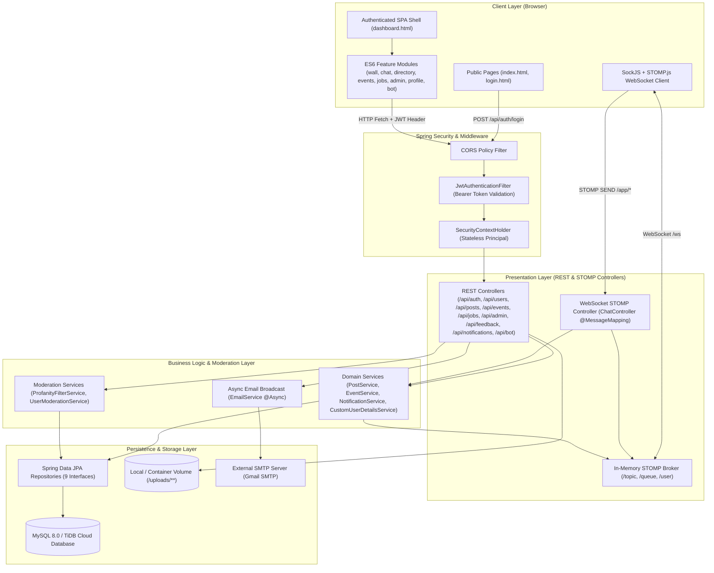
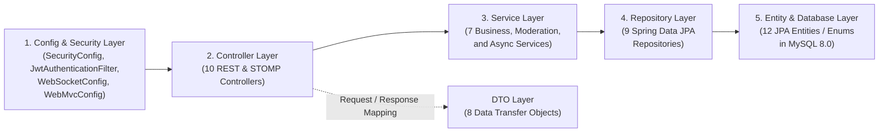
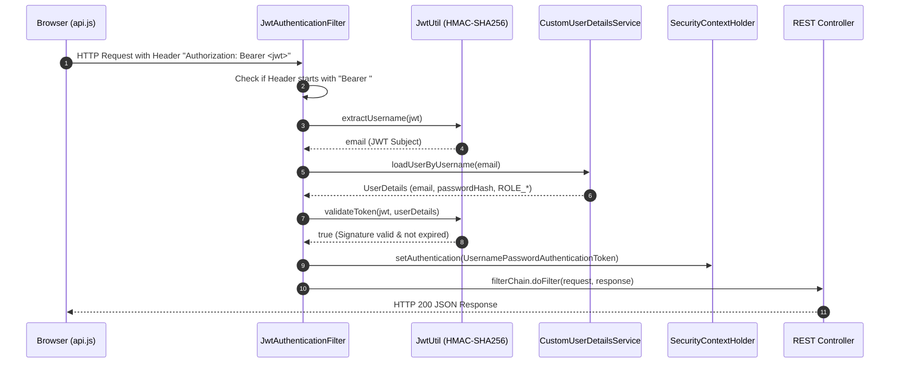
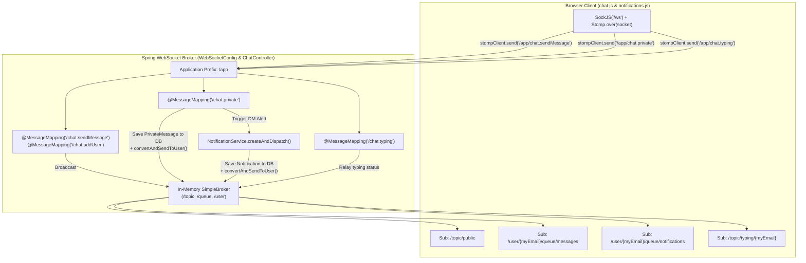
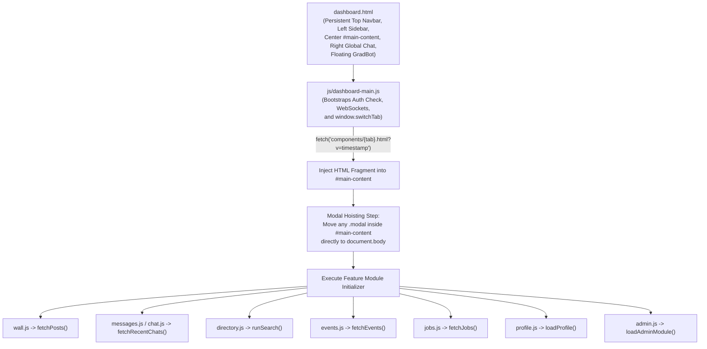
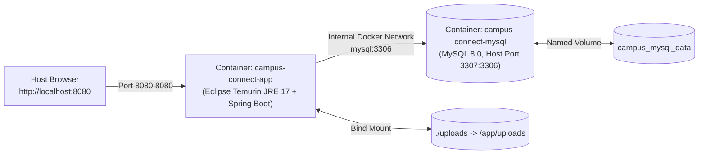

# 🏗️ System Architecture — Campus Connect (GradLink | BVICAM)

> **Live Deployment:** [https://campus-connect-live.onrender.com](https://campus-connect-live.onrender.com)

This document provides a comprehensive technical overview of the **Campus Connect (GradLink)** architecture, covering its layered Spring Boot backend, lightweight Single-Page Application (SPA) frontend shell, real-time WebSocket/STOMP messaging backbone, security filter chain, and cloud/container deployment topology.

---

## 1. High-Level System Overview

Campus Connect is built as a modular monolithic web application powered by **Java 17** and **Spring Boot 3.2.5**. It serves both static frontend assets and JSON/WebSocket APIs from a single unified runtime, backed by a relational MySQL 8.0 / TiDB Cloud database.

---

## 2. Layered Backend Architecture

The Java backend (`com.bvicam.campusconnect`) follows a clean 5-layer separation of concerns:

### Layer Responsibilities

| Layer | Package | Responsibilities |
| :--- | :--- | :--- |
| **Configuration & Security** | `com.bvicam.campusconnect.config` `com.bvicam.campusconnect.util` | Configures stateless Spring Security, intercepts requests via `JwtAuthenticationFilter`, registers the `/ws` SockJS/STOMP broker, exposes `/uploads/**` for post images, and seeds initial demo data via `DataSeeder`. |
| **Presentation (Controllers)** | `com.bvicam.campusconnect.controller` | Exposes REST endpoints under `/api/**` and STOMP message handlers under `/app/**`. Handles HTTP status codes, role verification, and DTO conversion. |
| **Business Logic (Services)** | `com.bvicam.campusconnect.service` | Encapsulates transactional domain logic, bilingual profanity detection (`ProfanityFilterService`), isolated moderation flag transactions (`UserModerationService`), real-time notification dispatch (`NotificationService`), and `@Async` bulk email broadcasting (`EmailService`). |
| **Data Access (Repositories)** | `com.bvicam.campusconnect.repository` | Spring Data JPA interfaces providing CRUD operations, derived query methods, and custom JPQL queries (e.g., multi-criteria directory search and bidirectional chat history). |
| **Domain Models & DTOs** | `com.bvicam.campusconnect.entity` `com.bvicam.campusconnect.dto` | JPA `@Entity` classes mapped to relational tables (with `@JsonIgnore` guards to prevent circular JSON serialization) and lightweight DTOs for clean API contracts. |

---

## 3. Authentication & Stateless Security Architecture

Campus Connect uses **stateless JWT authentication**. No HTTP server sessions are created (`SessionCreationPolicy.STATELESS`).

### Route Access Matrix (`SecurityConfig.java`)
- **Public Routes (`permitAll`):**
  - Static frontend pages and assets: `/`, `/index.html`, `/login.html`, `/dashboard.html`, `/components/**`, `/css/**`, `/js/**`, `/images/**`, `/uploads/**`
  - Authentication endpoints: `/api/auth/**`
  - WebSocket handshake endpoint: `/ws/**`
  - GradBot FAQ endpoint: `/api/bot/**`
- **Protected Routes (`authenticated`):**
  - All other `/api/**` endpoints require a valid Bearer JWT in the `Authorization` header.
  - Role-specific operations (`ADMIN` vs. `ALUMNI` vs. `STUDENT`) are enforced at the controller/service level using the authenticated `Principal` or `SecurityContextHolder`.

---

## 4. Real-Time WebSocket & STOMP Architecture

Real-time features (Global Chat, 1-on-1 Direct Messaging, Live Typing Indicators, and Instant Notification Badges/Toasts) run over a single multiplexed **SockJS + STOMP** connection established when `dashboard.html` loads.

---

## 5. Frontend SPA Shell & Modal Hoisting Architecture

Instead of heavy frontend build toolchains, Campus Connect uses a fast, native **ES6 Module SPA Shell** pattern:

### Why Modal Hoisting Matters
In `dashboard-main.js`, whenever `window.switchTab(tab)` injects a component fragment (`admin.html`, `events.html`, `directory.html`) into `#main-content`:
1. Any previously hoisted dynamic modals (`[data-cc-dynamic-modal="true"]`) and stale `.modal-backdrop` elements are disposed and removed.
2. Any `.modal` elements inside the newly loaded component are moved directly to `document.body` (`document.body.appendChild(modalEl)`).
3. This guarantees that component modals always share the top-level root stacking context with Bootstrap's `.modal-backdrop` (`z-index: 1050` vs. `.modal` `z-index: 1060`) and are never trapped inside `#main-content`.

---

## 6. Deployment & Container Topology

Campus Connect supports two primary deployment models:

### A. Production Cloud Topology (Render + TiDB Cloud)
- **Live URL:** [https://campus-connect-live.onrender.com](https://campus-connect-live.onrender.com)
- **Application Compute:** Hosted on **Render** using the root multi-stage [`Dockerfile`](../Dockerfile) (`eclipse-temurin:17-jre` runtime with container-tuned heap limits `-Xmx384m -Xms256m`).
- **Database:** Connected to **TiDB Cloud** (distributed MySQL-compatible serverless cluster) over TLS.

### B. Local Isolated Docker Compose Topology
Defined in [`docker-compose.yml`](../docker-compose.yml) so developers can run the entire stack locally without installing Java, Maven, or MySQL on their host machine:

