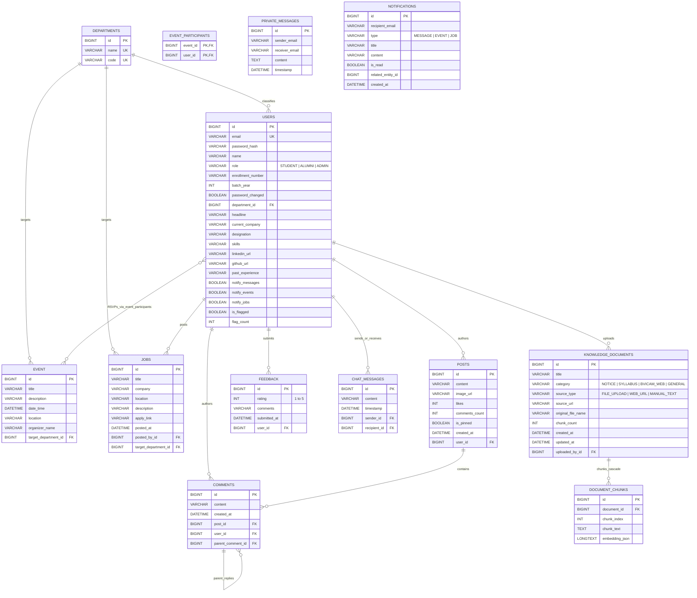

# 🗄️ Database Schema & ER Reference — Campus Connect (GradLink)

> **Live Deployment:** [https://campus-connect-live.onrender.com](https://campus-connect-live.onrender.com)

Campus Connect uses a relational **MySQL 8.0** (local Docker) / **TiDB Cloud** (production) database managed automatically by **Spring Data JPA / Hibernate** (`spring.jpa.hibernate.ddl-auto=update`).

---

## 1. Entity-Relationship Diagram (ERD)

---

## 2. Detailed Table Specifications

### 2.1 `users` — [`User.java`](../src/main/java/com/bvicam/campusconnect/entity/User.java)
Stores credentials, role authorization, academic metadata, professional portfolio fields, notification preferences, and automated moderation counters.

| Column | Type | Nullable | Default | Description |
| :--- | :--- | :--- | :--- | :--- |
| `id` | `BIGINT` (PK, Auto) | No | Auto | Primary key identifier. |
| `email` | `VARCHAR(255)` (Unique) | No | — | Login identifier and STOMP routing principal. |
| `password_hash` | `VARCHAR(255)` | No | — | BCrypt-hashed password (`@JsonIgnore`). |
| `name` | `VARCHAR(255)` | No | — | Full display name. |
| `role` | `VARCHAR(50)` | No | — | Enum string: `STUDENT`, `ALUMNI`, or `ADMIN`. |
| `enrollment_number` | `VARCHAR(255)` | Yes | `NULL` | University enrollment/roll number. |
| `batch_year` | `INT` | Yes | `NULL` | Graduation year (e.g., `2024`, `2025`). |
| `password_changed` | `BOOLEAN` | Yes | `false` | Tracks whether user changed their initial bulk-onboarded password. |
| `department_id` | `BIGINT` (FK) | Yes | `NULL` | Foreign key to `departments.id`. |
| `headline` | `VARCHAR(255)` | Yes | `NULL` | Professional tagline shown in Directory and Wall. |
| `current_company` | `VARCHAR(255)` | Yes | `NULL` | Current employer or organization. |
| `designation` | `VARCHAR(255)` | Yes | `NULL` | Job title / role at current company. |
| `skills` | `VARCHAR(255)` | Yes | `NULL` | Comma-separated technical skills (`Java, Spring Boot, React`). |
| `linkedin_url` | `VARCHAR(255)` | Yes | `NULL` | LinkedIn profile URL. |
| `github_url` | `VARCHAR(255)` | Yes | `NULL` | GitHub profile URL. |
| `past_experience` | `VARCHAR(2000)` | Yes | `NULL` | Bio / work experience summary. |
| `notify_messages` | `BOOLEAN` | No | `true` | Opt-in toggle for 1-on-1 direct message notifications. |
| `notify_events` | `BOOLEAN` | No | `true` | Opt-in toggle for campus event notifications. |
| `notify_jobs` | `BOOLEAN` | No | `true` | Opt-in toggle for job/referral notifications. |
| `is_flagged` | `BOOLEAN` | No | `false` | Set to `true` when `ProfanityFilterService` blocks a post/comment. |
| `flag_count` | `INT` | No | `0` | Cumulative count of profanity violations. |

---

### 2.2 `departments` — [`Department.java`](../src/main/java/com/bvicam/campusconnect/entity/Department.java)
Stores academic departments seeded on startup (`MCA`, `BJMC`).

| Column | Type | Nullable | Description |
| :--- | :--- | :--- | :--- |
| `id` | `BIGINT` (PK, Auto) | No | Primary key. |
| `name` | `VARCHAR(255)` (Unique) | No | Full department name (e.g., `Master of Computer Applications`). |
| `code` | `VARCHAR(255)` (Unique) | No | Short code (`MCA`, `BJMC`). |

---

### 2.3 `posts` — [`Post.java`](../src/main/java/com/bvicam/campusconnect/entity/Post.java)
Stores Campus Wall updates, photos, pinned state, and engagement counters.

| Column | Type | Nullable | Default | Description |
| :--- | :--- | :--- | :--- | :--- |
| `id` | `BIGINT` (PK, Auto) | No | Auto | Primary key. |
| `content` | `VARCHAR(2000)` | Yes | — | Post body text. |
| `image_url` | `VARCHAR(255)` | Yes | `NULL` | Local upload path (`/uploads/...`) or external URL. |
| `likes` | `INT` | No | `0` | Total likes count. |
| `comments_count` | `INT` | No | `0` | Cached total count of comments and replies. |
| `is_pinned` | `BOOLEAN` | No | `false` | Pinned posts always sort to the top of the Campus Wall. |
| `created_at` | `DATETIME` | Yes | `NOW()` | Creation timestamp. |
| `user_id` | `BIGINT` (FK) | Yes | — | Author reference (`users.id`). |

---

### 2.4 `comments` — [`Comment.java`](../src/main/java/com/bvicam/campusconnect/entity/Comment.java)
Supports both top-level post comments (`parent_comment_id IS NULL`) and nested threaded replies (`parent_comment_id = parent.id`).

| Column | Type | Nullable | Description |
| :--- | :--- | :--- | :--- |
| `id` | `BIGINT` (PK, Auto) | No | Primary key. |
| `content` | `VARCHAR(1000)` | No | Comment or reply text. |
| `created_at` | `DATETIME` | No | Creation timestamp (`@PrePersist`). |
| `post_id` | `BIGINT` (FK) | No | Parent post (`posts.id`). |
| `user_id` | `BIGINT` (FK) | No | Comment author (`users.id`). |
| `parent_comment_id` | `BIGINT` (FK) | Yes | Self-referential FK to `comments.id` for threaded replies. |

---

### 2.5 `event` & `event_participants` — [`Event.java`](../src/main/java/com/bvicam/campusconnect/entity/Event.java)
Stores campus events and their Many-to-Many RSVP attendance join table.

| Table | Column | Type | Description |
| :--- | :--- | :--- | :--- |
| `event` | `id` | `BIGINT` (PK, Auto) | Event primary key. |
| `event` | `title` | `VARCHAR(255)` | Event title. |
| `event` | `description` | `VARCHAR(1000)` | Detailed event agenda/description. |
| `event` | `date_time` | `DATETIME` | Scheduled date and time (`yyyy-MM-dd'T'HH:mm`). |
| `event` | `location` | `VARCHAR(255)` | Venue or online meeting link. |
| `event` | `organizer_name` | `VARCHAR(255)` | Optional organizer label. |
| `event` | `target_department_id` | `BIGINT` (FK) | Optional department filter (`departments.id`). |
| `event_participants` | `event_id` | `BIGINT` (PK, FK) | References `event.id`. |
| `event_participants` | `user_id` | `BIGINT` (PK, FK) | References `users.id`. |

---

### 2.6 `jobs` — [`Job.java`](../src/main/java/com/bvicam/campusconnect/entity/Job.java)
Stores job openings, internships, and internal referrals posted by Alumni and Admins.

| Column | Type | Nullable | Description |
| :--- | :--- | :--- | :--- |
| `id` | `BIGINT` (PK, Auto) | No | Primary key. |
| `title` | `VARCHAR(255)` | Yes | Job role or referral title. |
| `company` | `VARCHAR(255)` | Yes | Hiring company name. |
| `location` | `VARCHAR(255)` | Yes | Office city, hybrid, or remote. |
| `description` | `VARCHAR(1000)` | Yes | Job requirements and referral notes. |
| `apply_link` | `VARCHAR(255)` | Yes | External application URL or referral email address. |
| `posted_at` | `DATETIME` | Yes | Creation timestamp (`LocalDateTime.now()`). |
| `posted_by_id` | `BIGINT` (FK) | Yes | Author reference (`users.id`). |
| `target_department_id` | `BIGINT` (FK) | Yes | Optional department reference (`departments.id`). |

---

### 2.7 `private_messages` — [`PrivateMessage.java`](../src/main/java/com/bvicam/campusconnect/entity/PrivateMessage.java)
Active persistence table for 1-on-1 direct messages sent via STOMP WebSockets (`/app/chat.private`) and queried via `/api/messages/history`.

| Column | Type | Nullable | Description |
| :--- | :--- | :--- | :--- |
| `id` | `BIGINT` (PK, Auto) | No | Primary key. |
| `sender_email` | `VARCHAR(255)` | Yes | Authenticated sender's email. |
| `receiver_email` | `VARCHAR(255)` | Yes | Recipient's email. |
| `content` | `TEXT` | Yes | Message text body. |
| `timestamp` | `DATETIME` | Yes | Sent timestamp. |

---

### 2.8 `notifications` — [`Notification.java`](../src/main/java/com/bvicam/campusconnect/entity/Notification.java)
Stores persistent in-app notifications for messages, events, and job postings.

| Column | Type | Nullable | Default | Description |
| :--- | :--- | :--- | :--- | :--- |
| `id` | `BIGINT` (PK, Auto) | No | Auto | Primary key. |
| `recipient_email` | `VARCHAR(255)` | No | — | Target user's email. |
| `type` | `VARCHAR(50)` | No | — | Enum: `MESSAGE`, `EVENT`, or `JOB`. |
| `title` | `VARCHAR(255)` | No | — | Short alert headline. |
| `content` | `VARCHAR(1000)` | No | — | Detailed notification body. |
| `is_read` | `BOOLEAN` | No | `false` | Read status flag. |
| `related_entity_id` | `BIGINT` | Yes | `NULL` | Optional ID of the target event or job. |
| `created_at` | `DATETIME` | No | `NOW()` | Creation timestamp. |

---

### 2.9 `feedback` — [`Feedback.java`](../src/main/java/com/bvicam/campusconnect/entity/Feedback.java)
Captures user ratings and qualitative platform feedback for Admin review.

| Column | Type | Nullable | Description |
| :--- | :--- | :--- | :--- |
| `id` | `BIGINT` (PK, Auto) | No | Primary key. |
| `rating` | `INT` | Yes | Star rating (`1` to `5`). |
| `comments` | `VARCHAR(1000)` | Yes | Written feedback comment. |
| `submitted_at` | `DATETIME` | Yes | Submission timestamp. |
| `user_id` | `BIGINT` (FK) | Yes | Submitter reference (`users.id`). |

---

### 2.10 `knowledge_documents` — [`KnowledgeDocument.java`](../src/main/java/com/bvicam/campusconnect/entity/KnowledgeDocument.java)
Stores ingested documents, circulars, syllabi, and scraped BVICAM web pages for RAG intelligence.

| Column | Type | Nullable | Description |
| :--- | :--- | :--- | :--- |
| `id` | `BIGINT` (PK, Auto) | No | Primary key. |
| `title` | `VARCHAR(255)` | No | Document or page headline title. |
| `category` | `VARCHAR(32)` | No | Enum: `NOTICE`, `SYLLABUS`, `BVICAM_WEB`, `GENERAL`. |
| `source_type` | `VARCHAR(32)` | No | Enum: `FILE_UPLOAD`, `WEB_URL`, `MANUAL_TEXT`. |
| `source_url` | `VARCHAR(1024)` | Yes | External URL if crawled from bvicam.in. |
| `original_file_name` | `VARCHAR(255)` | Yes | Filename if uploaded as PDF/text. |
| `chunk_count` | `INT` | No | Total number of text segments partitioned. |
| `uploaded_by_id` | `BIGINT` (FK) | Yes | Admin user reference (`users.id`). |
| `created_at` | `DATETIME` | No | Ingestion timestamp. |
| `updated_at` | `DATETIME` | Yes | Last update timestamp. |

---

### 2.11 `document_chunks` — [`DocumentChunk.java`](../src/main/java/com/bvicam/campusconnect/entity/DocumentChunk.java)
Stores individual text chunks and their 768-dimensional vector embeddings generated by `nomic-embed-text`.

| Column | Type | Nullable | Description |
| :--- | :--- | :--- | :--- |
| `id` | `BIGINT` (PK, Auto) | No | Primary key. |
| `document_id` | `BIGINT` (FK) | No | Foreign key referencing `knowledge_documents.id` (cascading delete). |
| `chunk_index` | `INT` | No | Zero-indexed chunk order within parent document. |
| `chunk_text` | `TEXT` (`@Lob`) | No | Overlapping text slice (~600 characters). |
| `embedding_json` | `LONGTEXT` (`@Lob`) | No | Serialized 768-dimensional double array JSON. |
