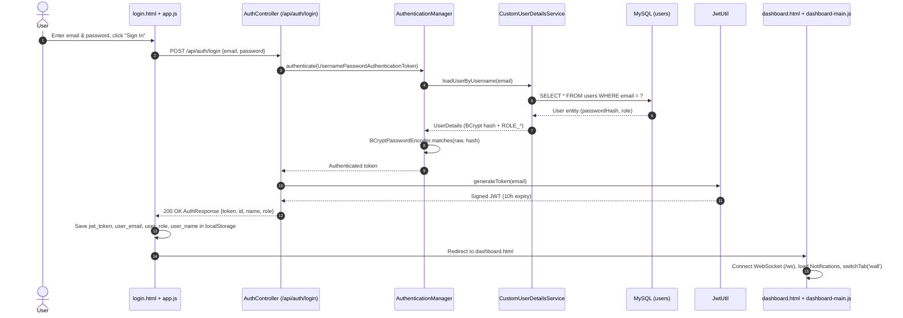
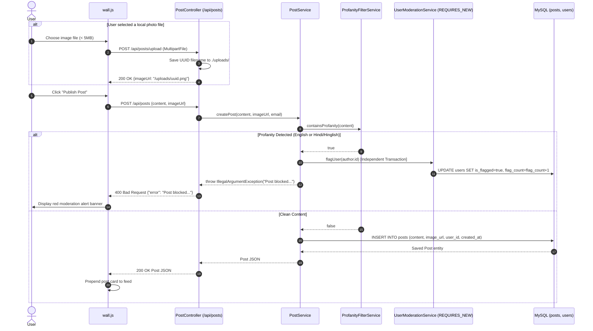
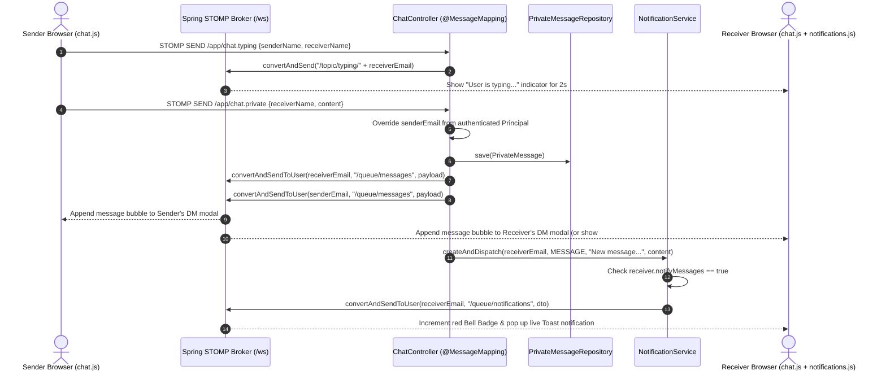
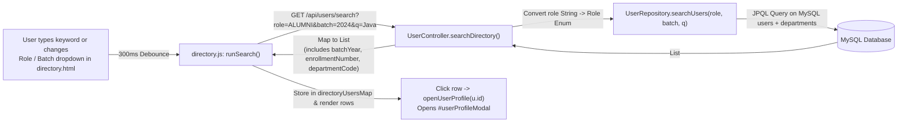
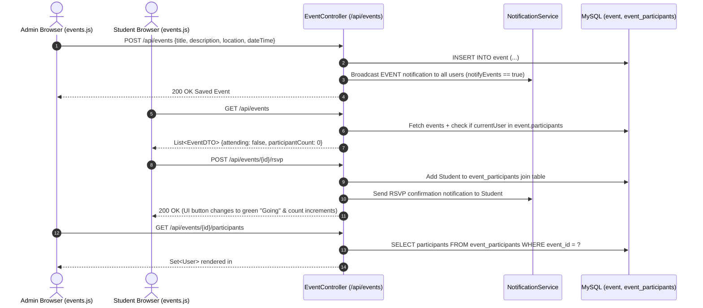
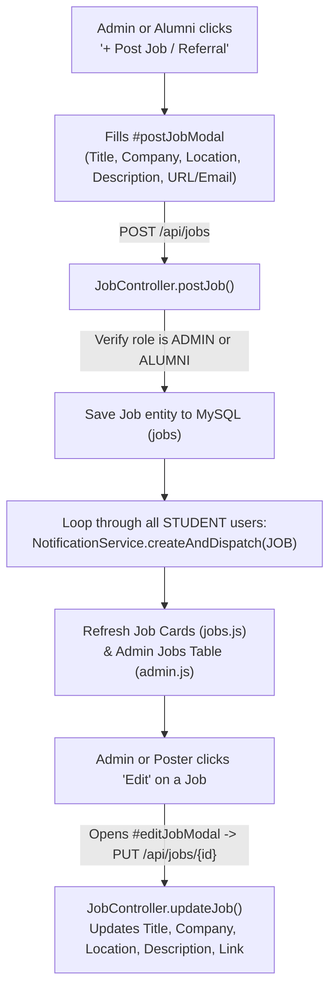

# 🔄 End-to-End Data Flows — Campus Connect (GradLink)

> **Live Deployment:** [https://campus-connect-live.onrender.com](https://campus-connect-live.onrender.com)

This document traces the complete end-to-end lifecycle of user actions in **Campus Connect**, from browser DOM events through the Spring Security filter chain, REST/STOMP controllers, business/moderation services, JPA repositories, and MySQL database, back to real-time UI updates.

---

## 1. User Login & JWT Session Initialization

When a student, alumnus, or administrator signs in via `login.html`:

---

## 2. Campus Wall Post Creation, Photo Upload & Bilingual Profanity Moderation

When a user publishes a post on the Campus Wall (`wall.html` + `wall.js`), the flow supports optional multipart image upload followed by automated bilingual profanity screening (`ProfanityFilterService`) and isolated user flagging (`UserModerationService` with `Propagation.REQUIRES_NEW`):

---

## 3. Real-Time 1-on-1 Direct Messaging & Live Notifications (STOMP WebSockets)

Private messaging combines persistent relational storage (`private_messages` table) with instant push delivery over STOMP queues:

---

## 4. Directory Search & Multi-Criteria Filtering

When a user types in the Directory search box or selects a Role (`STUDENT` / `ALUMNI`) or Graduation Batch (`2020`–`2025`):

---

## 5. Event Creation, RSVP Toggling & Participant Inspection

---

## 6. Jobs & Referrals Lifecycle (Admin & Alumni)

Both **Alumni** and **Admins** can post, edit, and delete career opportunities and internal referrals from either the **Jobs & Referrals** tab or the **Admin Workspace -> Jobs & Referrals** sub-tab:

---

## 7. Admin Bulk User Onboarding & Asynchronous Email Broadcast

### A. Bulk Excel / CSV User Import
1. Admin selects a `.xlsx` or `.csv` file in **Admin Workspace -> Manage Users** and clicks **Upload `.xlsx / .csv`**.
2. `admin.js` sends a ` multipart/form-data` request to `POST /api/admin/bulk-upload`.
3. `AdminController.bulkUpload` detects the file extension:
   - `.xlsx`: Parsed with **Apache POI** (`XSSFWorkbook`).
   - `.csv`: Parsed line-by-line via `BufferedReader`.
4. Each row resolves or creates the `Department` (`MCA` / `BJMC`), checks for duplicate email addresses, hashes the default password (`Bvicam@2025`) with `BCryptPasswordEncoder`, sets `passwordChanged = false`, and saves all new users in a single batch (`userRepository.saveAll(usersToSave)`).

### B. Asynchronous Campus-Wide Email Broadcast
1. Admin enters a Subject and Message in **Admin Workspace -> Broadcast Email** and clicks **Send Broadcast to Community**.
2. `POST /api/admin/broadcast` collects all registered user email addresses from `UserRepository` and invokes `emailService.sendBroadcastEmail(emails, subject, message)`.
3. Because `sendBroadcastEmail` is annotated with `@Async`, Spring immediately returns `200 OK ("✅ Broadcast initiated for N users.")` to the browser while dispatching the SMTP emails on a background worker thread.
