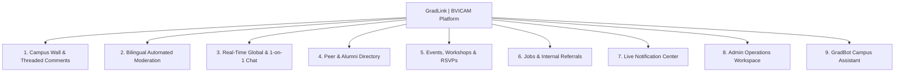

# ✨ Features & Capabilities Guide — Campus Connect (GradLink)

> **Live Deployment:** [https://campus-connect-live.onrender.com](https://campus-connect-live.onrender.com)

**Campus Connect (GradLink)** is an all-in-one campus networking, career referral, real-time messaging, and community management platform tailored for **BVICAM** students, alumni, and administrators.

---

## 1. Role-Based Access Control (RBAC) Matrix

Every user account is assigned one of three roles (`STUDENT`, `ALUMNI`, or `ADMIN`), governing both UI visibility and backend API authorization:

| Feature / Capability | `STUDENT` | `ALUMNI` | `ADMIN` |
| :--- | :---: | :---: | :---: |
| Sign in with JWT Authentication & Change Password | ✅ | ✅ | ✅ |
| Publish Posts, Upload Photos, Like & Reply on Campus Wall | ✅ | ✅ | ✅ |
| Pin / Unpin Announcements on Campus Wall | ❌ | ❌ | ✅ |
| Delete Own Posts & Comments | ✅ | ✅ | ✅ |
| Moderate / Delete Any User's Post or Comment | ❌ | ❌ | ✅ |
| Global Campus Chat & 1-on-1 Private Direct Messaging | ✅ | ✅ | ✅ |
| Search Peer & Alumni Directory & View Member Profiles | ✅ | ✅ | ✅ |
| Browse Events & Toggle 1-Click RSVP Attendance | ✅ | ✅ | ✅ |
| Create, Edit, Delete Events & View RSVP Participant Lists | ❌ | ❌ | ✅ |
| Browse & Apply to Jobs / Internal Referrals | ✅ | ✅ | ✅ |
| Post, Edit & Delete Jobs and Internal Referrals | ❌ | ✅ | ✅ |
| Edit Own Professional Portfolio & Notification Preferences | ✅ | ✅ | ✅ |
| Submit Platform Star Rating & Feedback | ✅ | ✅ | ✅ |
| Admin Workspace: Create, Edit, Delete Users & Reset Passwords | ❌ | ❌ | ✅ |
| Admin Workspace: Bulk Upload Users via `.xlsx` or `.csv` | ❌ | ❌ | ✅ |
| Admin Workspace: Review & Unflag Profanity-Flagged Users | ❌ | ❌ | ✅ |
| Admin Workspace: Send Async Campus-Wide Broadcast Emails | ❌ | ❌ | ✅ |
| Admin Workspace: Review All Submitted Member Feedback | ❌ | ❌ | ✅ |
| Admin Workspace: Ingest Notices (PDF/TXT) & Scrape BVICAM URLs into GradBot RAG | ❌ | ❌ | ✅ |
| Chat with **GradBot** AI Campus Assistant (Ollama `gemma4:e4b` + Hybrid RAG) | ✅ | ✅ | ✅ |

---

## 2. Core Feature Modules in Detail

---

### 2.1 Campus Wall (Community Feed & Threaded Discussions)
- **Rich Post Composer:** Users can publish text updates, upload local photos (`PNG`, `JPG`, `GIF`, `WEBP` up to 5 MB via `POST /api/posts/upload` with live image preview), or attach external image URLs.
- **Pinned Announcements:** Administrators can pin important notices (`PUT /api/posts/{id}/pin`), keeping them anchored at the top of the feed with a highlighted badge.
- **Likes & Nested Replies:** Supports 1-click post likes and multi-level threaded comments (`parentCommentId` hierarchy) where users can reply to specific comments or delete their own comments.

---

### 2.2 Bilingual Automated Content Moderation (`ProfanityFilterService`)
- **English + Hindi/Hinglish Detection:** Automatically screens every Campus Wall post and comment before persistence.
- **Obfuscation & Evasion Resistance:**
  - Normalizes leetspeak substitutions (`@ -> a`, `$ -> s`, `0 -> o`, `1 -> i`, `3 -> e`, `! -> i`).
  - Collapses elongated characters (e.g., `fuuuuck -> fuck`).
  - Strips common English suffixes (`-ing`, `-er`, `-ed`, `-s`) to catch inflected variants.
- **Isolated Flagging Transaction (`UserModerationService`):**
  - When profanity is detected, the post/comment is blocked with HTTP `400`, while a separate `Propagation.REQUIRES_NEW` transaction marks the user (`isFlagged = true`) and increments `flagCount` so Admins can audit repeat offenders in the Admin Workspace.

---

### 2.3 Real-Time Global Chat & 1-on-1 Direct Messaging
- **Global Campus Chat:** Always-accessible right-hand chat panel (`#chatArea`) connected to `/topic/public` over SockJS + STOMP.
- **Private 1-on-1 Messaging:**
  - Launchable from the **Directory**, **Member Profile Modal**, or **Messages** tab.
  - Persists every message in `private_messages` and pushes real-time frames to `/user/{email}/queue/messages`.
  - **Live Typing Indicator:** Broadcasts `/app/chat.typing` events so the recipient sees *"User is typing..."* in real time.

---

### 2.4 Peer & Alumni Directory
- **Live Debounced Search:** 300ms debounced search bar combined with **Role** (`ALL`, `STUDENT`, `ALUMNI`) and **Graduation Batch** (`2020`–`2025`) filters.
- **Multi-Field Matching:** Searches across `name`, `email`, `skills`, `currentCompany`, `headline`, and `designation`.
- **Interactive Member Profile Modal (`#userProfileModal`):** Displays full academic details (Department, Batch Year, Enrollment No), career summary (Headline, Company, Designation, Skills, Bio), clickable **LinkedIn** & **GitHub** buttons, and a **Send Direct Message** shortcut.

---

### 2.5 Campus Events & RSVP Management
- **Interactive Event Cards:** Displays event date/time badges, venue/meeting link, description, live **Going** counter (`participantCount`), and a 1-click **RSVP / Going** toggle button.
- **Admin Event Controls:**
  - **Create & Edit Events:** Full modal workflow (`#eventModal` and `#editEventModal`) with local date-time preservation.
  - **View RSVP Participants (`#participantsModal`):** Admins can inspect the live list of all students and alumni who have RSVP'd to any event.

---

### 2.6 Jobs & Internal Referrals Board
- **Alumni & Admin Publishing:** Both `ALUMNI` and `ADMIN` users can post job openings, internships, and internal referrals (`#postJobModal`) and edit or delete existing listings (`#editJobModal`).
- **Smart Link Formatting:** Automatically detects whether `applyLink` is an email address (converting it to `mailto:...`) or a web URL (ensuring `https://...`).
- **Instant Student Alerts:** Publishing a new opportunity automatically dispatches a `JOB` notification to all students who have Career Alerts enabled.

---

### 2.7 Real-Time Notification Center & Preferences
- **Live Bell Badge & Toast Popups:** Subscribes to `/user/{email}/queue/notifications` to update the navbar unread badge and display a non-intrusive Bootstrap toast whenever a new message, event, or job is posted.
- **Granular User Preferences:** In **Profile Settings**, users can independently toggle notifications for:
  - **Direct Messages** (`notifyMessages`)
  - **Campus Events** (`notifyEvents`)
  - **Career Alerts** (`notifyJobs`)

---

### 2.8 Admin Operations Workspace
Accessible exclusively to `ADMIN` users via the **Admin Workspace** navigation tab, organized into 4 operational sub-tabs:
1. **Manage Users:**
   - **Add Individual User (`#createUserModal`):** Create student, alumni, or admin accounts with full academic and career fields.
   - **Edit User Profile (`#editUserModal`):** Update any user's role, department (`MCA` / `BA(JMC)`), batch year, enrollment number, company, skills, or bio, plus 1-click **Password Reset** (`Bvicam@2025`).
   - **Bulk Onboarding (`.xlsx` / `.csv`):** Upload spreadsheets to provision hundreds of accounts in seconds.
   - **Moderation Status & Unflag:** View `Clean` vs. `Flagged (Nx)` badges and clear flags with 1 click.
2. **Jobs & Referrals:** Dedicated management table to post, edit, or delete any career listing on the platform.
3. **Feedback & Ratings:** Review star ratings (`1`–`5` ⭐) and written suggestions submitted by users.
4. **Broadcast Email:** Send asynchronous campus-wide email announcements to all registered users via `EmailService`.
5. **GradBot Knowledge Base:** Dedicated administrative sub-tab to ingest official notices (PDFs, TXT, MD) via Apache PDFBox, scrape external URLs (e.g. `https://bvicam.in`) via Jsoup, generate 768-dimensional vector embeddings, and audit/delete indexed sources.

---

### 2.9 GradBot AI Campus Assistant & Hybrid RAG Engine
- **Powered by Local Ollama (`gemma4:e4b`):** Privacy-first, zero cloud API fees, and fully parameterized via `application.properties`.
- **Hybrid RAG Context:**
  - **Vector Retrieval:** In-memory cosine similarity ranking over 768-dimensional normalized embeddings (`nomic-embed-text`) stored in `document_chunks`.
  - **Live Domain Context:** Real-time JPA queries to `EventRepository`, `JobRepository`, and `UserRepository` for up-to-the-minute upcoming event dates, active referral openings, and batchmate queries.
- **Clickable Citations:** GradBot answers provide verified HTTP/HTTPS citation links and document badges pointing back to official sources.
- **Dual-Layer XSS Defense:** Strict character escaping + DOMPurify client-side sanitization preventing script injection or attribute-breaking payloads.
- **Interactive Floating Drawer (`#botWindow`):** Quick-prompt chips for **MCA Syllabus**, **Exam Notices**, **Upcoming Events**, **Placements**, **Active Job Openings**, and **Batch Directory**.
