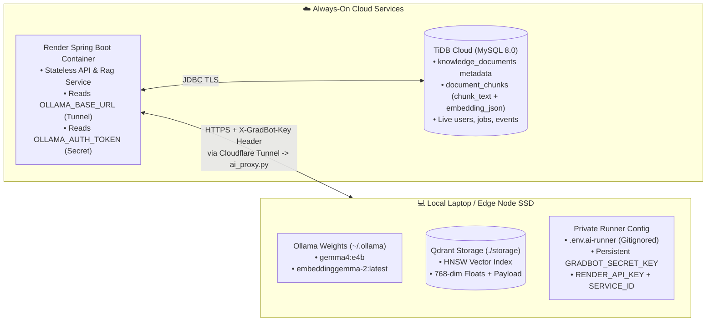
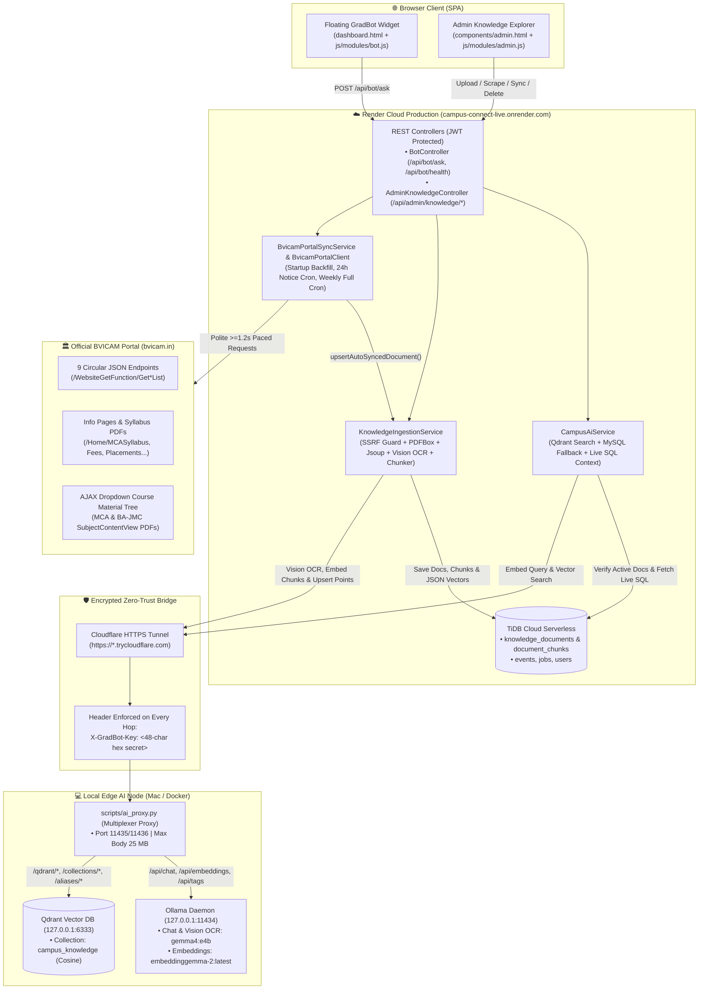
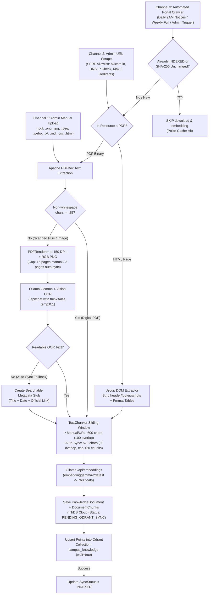
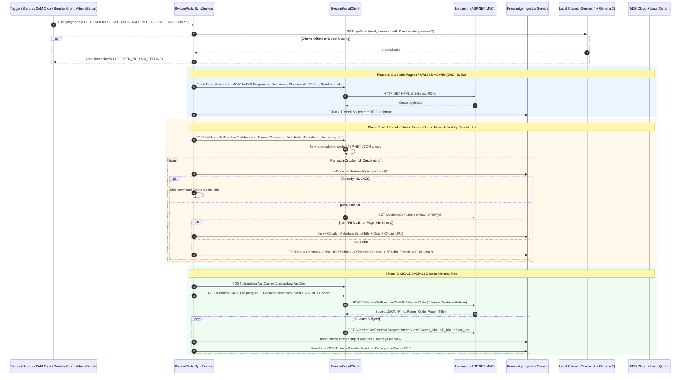
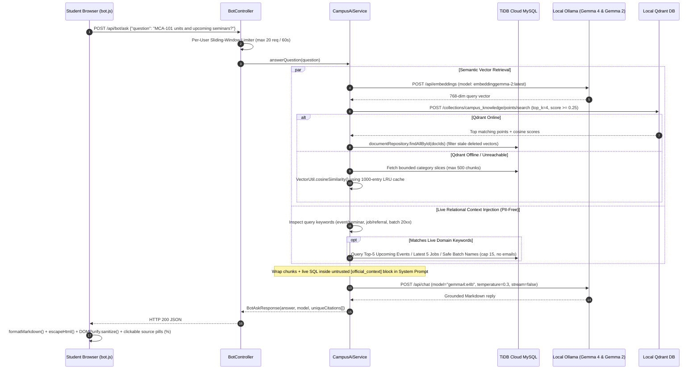
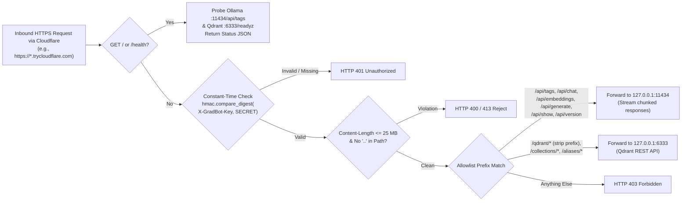

# 🎓 GradBot AI: System Documentation, Tech Stack, Architecture & Flowcharts

> **Project:** Campus Connect (`GradLink`) — BVICAM Campus & Alumni Platform  
> **Live Deployment:** [`https://campus-connect-live.onrender.com`](https://campus-connect-live.onrender.com)  
> **AI Engine:** Hybrid Edge-Cloud RAG (**Google Gemma 4** + **Gemma 2 Embeddings** + **Qdrant Vector DB** + **Automated BVICAM Portal Sync**)

---

## 1. Brief Executive Overview

**GradBot** is an AI-powered campus assistant embedded directly inside the GradLink dashboard ([`dashboard.html`](../src/main/resources/static/dashboard.html#L368-L408)). It enables students, alumni, and faculty at **BVICAM (Bharati Vidyapeeth's Institute of Computer Applications and Management, New Delhi)** to ask natural-language questions about circulars, exam schedules, syllabi, MCA/BA(JMC) course materials, fees, admissions, live jobs, batchmates, and campus events — and receive **Markdown answers with clickable similarity citations**.

### Why a Hybrid Edge-Cloud Design?
1. **Fragmented Institutional Knowledge:** Notices, circulars, syllabi, and semester-wise notes live across ASP.NET AJAX feeds and nested dropdowns on [`bvicam.in`](https://bvicam.in/).
2. **Scanned Image PDFs:** Legacy notices and date sheets are often scanned images without selectable text, defeating normal keyword search.
3. **Zero Cloud GPU Cost:** Render's free web container (512 MB RAM) cannot host multi-billion-parameter LLMs or Vision models, and cloud GPUs + managed vector DBs cost \$50–\$200/month.

**Solution:** Campus Connect decouples **Cloud Web Hosting** from **Edge AI & Vector Storage**:
- **Render Cloud (Singapore)** runs the Spring Boot backend, REST APIs, and scheduled portal crawler, storing relational data and backup embeddings in **TiDB Cloud Serverless**.
- **Local Edge Hardware (MacBook / Docker Runner)** runs **Ollama** (`gemma4:e4b` for chat + Vision OCR, `embeddinggemma-2:latest` for 768-dim vectors) and **Qdrant** (`campus_knowledge` HNSW index) at **\$0/month**.
- A zero-trust **Cloudflare HTTPS Tunnel** connects Render to a local Python multiplexer ([`scripts/ai_proxy.py`](../scripts/ai_proxy.py)), routing both LLM calls and Qdrant vector searches through one authenticated HTTPS endpoint.

---

## 2. Complete Technology Stack ("What All We Have Used")

| Layer | Technology / Model | Config / Version | Role in GradBot |
| :--- | :--- | :--- | :--- |
| **Chat & Reasoning LLM** | **Google Gemma 4 via Ollama** | `gemma4:e4b` (`temperature: 0.3`) | Synthesizes cited Markdown answers grounded strictly in retrieved context + live SQL data ([`OllamaClientService.java`](../src/main/java/com/bvicam/campusconnect/service/OllamaClientService.java#L162-L189)). |
| **Vision OCR Engine** | **Gemma 4 Multimodal Vision** | `think: false`, `temperature: 0.1` | Transcribes scanned PDFs (rendered to RGB PNG at `150 DPI` via PDFBox `PDFRenderer`) & uploaded notice images (`up to 15 pages` manual, `3 pages` auto-sync) ([`OllamaClientService.java`](../src/main/java/com/bvicam/campusconnect/service/OllamaClientService.java#L209-L242)). |
| **Embedding Model** | **Google Gemma 2 Embeddings** | `embeddinggemma-2:latest` (`768-dim`) | Vectorizes document chunks and incoming user questions via Ollama `/api/embeddings`. |
| **Vector Database** | **Qdrant** | Collection: `campus_knowledge` (`Cosine`, `HNSW`) | Primary ultra-fast ANN similarity search storing point payloads (`chunk_id`, `document_id`, `chunk_index`, `title`, `category`, `chunk_text`, `source_info`) ([`QdrantClientService.java`](../src/main/java/com/bvicam/campusconnect/service/QdrantClientService.java)). |
| **Relational DB & Backup Store** | **TiDB Cloud Serverless (MySQL 8.0)** | Hibernate / Spring Data JPA (`H2` in `local` profile) | Stores `knowledge_documents`, `document_chunks` (full `chunk_text` + `embedding_json` fallback), and live domain tables (`events`, `jobs`, `users`). |
| **Backend Framework** | **Spring Boot / Java 17** | Spring Boot `4.0.0`, Spring Security (JWT) | Orchestrates RAG ([`CampusAiService.java`](../src/main/java/com/bvicam/campusconnect/service/CampusAiService.java)), ingestion, rate limiting, and cron syncing. |
| **Document & Web Parsers** | **Apache PDFBox** + **Jsoup** | PDFBox `3.0.3`, Jsoup `1.18.3` | Extracts digital PDF text, renders scanned pages, strips boilerplate HTML nav/footers, and unwraps BVICAM tables. |
| **Edge Proxy & Multiplexer** | **Python 3 `ThreadingHTTPServer`** | [`scripts/ai_proxy.py`](../scripts/ai_proxy.py) (`Port 11435/11436`) | Zero-dependency gatekeeper verifying `X-GradBot-Key` via constant-time `hmac.compare_digest()` and splitting `/api/*` (Ollama) vs `/qdrant/*` (Qdrant). |
| **Zero-Trust Bridge** | **Cloudflare Tunnel** | `cloudflared` (`trycloudflare.com`) | Exposes local edge proxy over encrypted HTTPS without router port forwarding; [`start-ai-runner.sh`](../start-ai-runner.sh) auto-syncs Render env vars + triggers rolling deploy. |
| **Frontend Widget & Admin** | **Vanilla ES6 JS + Bootstrap 5 + DOMPurify** | [`bot.js`](../src/main/resources/static/js/modules/bot.js), [`admin.js`](../src/main/resources/static/js/modules/admin.js) | Renders Markdown replies safely (escaped + DOMPurify 3.0.9), similarity score badges (`%`), quick-prompt chips, and Admin Knowledge Explorer. |

---

## 3. Where Everything Lives (Storage & Data Placement Map)

Understanding where models, text chunks, and vector indexes reside explains how Render Cloud talks to local AI hardware without losing data when the tunnel restarts:

| Asset | Physical Location | What Happens If AI Runner Stops? |
| :--- | :--- | :--- |
| **`gemma4:e4b` & `embeddinggemma-2`** | Local SSD (`~/.ollama` or Docker volume `campus_ai_ollama_data`) | Stays cached on disk; next startup loads instantly without re-downloading. |
| **Qdrant Vector Index (`campus_knowledge`)** | Local SSD (`./storage/` or Docker volume `campus_ai_qdrant_data`) | Persists on disk; when offline, `CampusAiService` automatically falls back to TiDB relational cosine similarity on `document_chunks`. |
| **Document Metadata, Chunks & Backup Vectors** | **TiDB Cloud** (`knowledge_documents`, `document_chunks`) | Always online 24/7 in cloud; survives restarts and tunnel URL changes. |
| **Shared Auth Secret (`GRADBOT_SECRET_KEY`)** | Saved once in local `.env.ai-runner` (`chmod 600`) | **Remains identical across restarts** so Render never loses its matching secret; only `OLLAMA_BASE_URL` updates per new tunnel session. |

---

## 4. High-Level System Architecture Flowchart

---

## 5. End-to-End Working Flows

### 5.1. Knowledge Ingestion Pipeline (3 Input Channels → Dual Storage)

GradBot ingests knowledge through **three paths** inside [`KnowledgeIngestionService.java`](../src/main/java/com/bvicam/campusconnect/service/KnowledgeIngestionService.java):

### 5.2. Automated BVICAM Portal Crawler Sequence ([`BvicamPortalSyncService.java`](../src/main/java/com/bvicam/campusconnect/service/BvicamPortalSyncService.java))

The crawler operates single-threaded (`AtomicBoolean syncInProgress`), enforces a minimum polite delay (`>= 1200 ms`, floor `500 ms`) with `User-Agent: CampusConnect-GradBot/1.0`, and verifies Ollama + required models are healthy **before** sending a single request to `bvicam.in`:

### 5.3. Student Question-Answering RAG Flow ([`CampusAiService.java`](../src/main/java/com/bvicam/campusconnect/service/CampusAiService.java))

### 5.4. Reverse Proxy Multiplexer Flow ([`scripts/ai_proxy.py`](../scripts/ai_proxy.py))

---

## 6. Failover & Fault Tolerance Matrix

GradBot is built so Render production **never crashes** even when laptops sleep or `bvicam.in` returns partial errors:

| Component Failure | Automatic Resilience Behavior |
| :--- | :--- |
| **Qdrant Offline (Ollama Online)** | `QdrantClientService.searchOptional()` returns `Optional.empty()`. `CampusAiService` smoothly falls back to TiDB relational slices (`NOTICE`, `SYLLABUS`, `COURSE_MATERIAL`, `BVICAM_WEB`) and computes exact cosine similarity via [`VectorUtil.java`](../src/main/java/com/bvicam/campusconnect/util/VectorUtil.java) using a 1,000-entry synchronized LRU embedding cache. |
| **Whole Edge AI Runner Offline** | `OllamaClientService.generateChatResponse()` catches timeout/IO errors and returns a helpful **Standby Mode** response while keeping Wall, Events, Jobs, Directory, and WebSocket Chat 100% online. |
| **Broken/404 Notice PDF on `bvicam.in`** | `BvicamPortalSyncService` isolates single-document non-transport errors and indexes a **metadata stub** (circular title, ID, date, official URL) so students still discover the notice. |
| **Expired ASP.NET Anti-Forgery Token** | `BvicamPortalClient.fetchSubjects()` catches HTTP `500`/`403`, re-fetches `/Home/MCACourse` or `/Home/BajmcCourse` for a fresh `__RequestVerificationToken` + cookie, and retries once automatically. |
| **BVICAM Portal Overload / Outage** | Immediately pauses on HTTP `429`/`503` (`STOPPED_THROTTLED`) or after `5` consecutive transport errors (`ABORTED_REMOTE_ERRORS`). |
| **Qdrant Unavailable During Sync** | Documents save to TiDB with `SyncStatus.PENDING_QDRANT_SYNC`; embeddings never drop silently. |

---

## 7. Security & Defense-in-Depth Controls

- **SSRF Protection ([`KnowledgeIngestionService.java`](../src/main/java/com/bvicam/campusconnect/service/KnowledgeIngestionService.java#L552-L635)):** Enforces domain allowlists (`ai.scrape.allowed-domains=bvicam.in`), blocks non-HTTP/HTTPS schemes, permits only ports `80`/`443`, follows redirects manually (`max 2 hops`, re-validating every hop), and rejects DNS resolutions pointing to loopback, link-local, RFC 1918 private networks, IPv6 ULA (`fc00::/7`), or CGNAT (`100.64.0.0/10`).
- **CWE-319 Cleartext Token Guard ([`OllamaClientService.java`](../src/main/java/com/bvicam/campusconnect/service/OllamaClientService.java#L79-L86), [`QdrantClientService.java`](../src/main/java/com/bvicam/campusconnect/service/QdrantClientService.java#L60-L67)):** Refuses to boot if `X-GradBot-Key` auth tokens are configured against a non-loopback plain `http://` URL.
- **Role-Based Access Control & Rate Limiting ([`BotController.java`](../src/main/java/com/bvicam/campusconnect/controller/BotController.java#L26-L99)):** Chat requires JWT authentication and enforces a **20 requests / 60-second** sliding window per user (`HTTP 429` above limit); all `/api/admin/knowledge/**` endpoints strictly require `ROLE_ADMIN`.
- **Prompt Injection & XSS Defense:** System instructions wrap retrieved chunks and live SQL context inside `<official_context>` untrusted-data boundaries. Frontend rendering escapes HTML entities first (`escapeHtml`), rejects non-HTTP(S) citation URLs (`safeHttpUrl`), and runs **DOMPurify 3.0.9** before injecting into the DOM.

---

## 8. REST API Endpoints & Operational Commands

### API Reference

| Endpoint | Access | Request / Notes |
| :--- | :--- | :--- |
| `POST /api/bot/ask` | Authenticated (`STUDENT` / `ALUMNI` / `ADMIN`) | Body: `{"question": "..."}` → Returns `{answer, model, citations[]}` |
| `GET /api/bot/health` | Authenticated | Live health JSON for Ollama (`ONLINE`/`STANDBY`) and Qdrant (`ONLINE`/`OFFLINE`) |
| `POST /api/admin/knowledge/upload` | `ADMIN` | Multipart file upload + `title` + `category` |
| `POST /api/admin/knowledge/scrape-url` | `ADMIN` | Body: `{url, title, category}` (`bvicam.in` allowlisted) |
| `GET /api/admin/knowledge/documents` | `ADMIN` | Lists all indexed documents with `chunkCount` and `syncStatus` |
| `DELETE /api/admin/knowledge/documents/{id}` | `ADMIN` | Removes document + chunks from TiDB and purges Qdrant points by `document_id` |
| `POST /api/admin/knowledge/sync-bvicam?mode=...` | `ADMIN` | Modes: `FULL`, `NOTICES`, `SYLLABUS_AND_INFO`, `COURSE_MATERIALS`, `COURSE_MATERIALS_MCA`, `COURSE_MATERIALS_BAJMC` |
| `GET /api/admin/knowledge/sync-status` | `ADMIN` | Live progress snapshot (`phase`, `discoveredCount`, `indexedNewCount`, `scannedFallbackCount`, `updatedCount`, `skippedExistingCount`, `failedCount`) |

### Automated Render Deployment Loop ([`start-ai-runner.sh`](../start-ai-runner.sh#L274-L301))

1. Verifies Python 3, `cloudflared`, local Ollama (`11434`), `gemma4:e4b`, `embeddinggemma-2`, and Qdrant (`6333` — auto-downloading prebuilt v1.20.0 binary if absent).
2. Loads persistent `GRADBOT_SECRET_KEY`, `RENDER_API_KEY`, and `RENDER_SERVICE_ID` from gitignored `.env.ai-runner` (`chmod 600`).
3. Scans from `PROXY_PORT` (`11435`+) and auto-picks the next free TCP port if another service occupies it.
4. Launches [`scripts/ai_proxy.py`](../scripts/ai_proxy.py) + Cloudflare Tunnel and verifies `200 OK` at `/api/tags`.
5. Calls `PUT /v1/services/{id}/env-vars/OLLAMA_BASE_URL` and `OLLAMA_AUTH_TOKEN`, then calls `POST /v1/services/{id}/deploys` so Render immediately restarts into the live tunnel.

### Quick CLI Cheat Sheet

| Operation | Command |
| :--- | :--- |
| **Start Native Mac Edge Runner (Auto-Syncs Render)** | `./start-ai-runner.sh` |
| **Start Portable Docker Edge Runner (macOS / Linux / Windows)** | `./start-ai-runner-docker.sh` |
| **Run 100% Local Full-Stack Dev Server (H2 DB + Local AI)** | `./run-local.sh` |
| **Verify Local Proxy + Qdrant + Ollama Health** | `curl http://127.0.0.1:11436/health` |
| **Inspect Qdrant Vector Count & Status** | `curl http://localhost:6333/collections/campus_knowledge` |
| **Verify Loaded Ollama Models** | `ollama list` |
