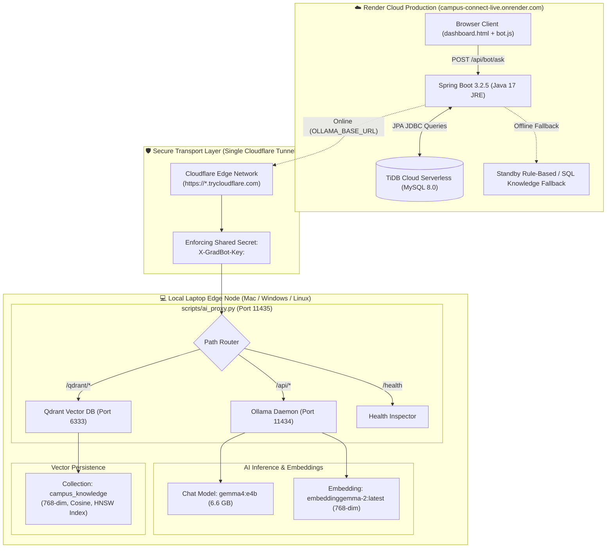

# 💻 Portable AI Runner & Hybrid Cloud Architecture Guide
## Bridging Local Laptop Hardware (Ollama + Qdrant) to Render Cloud (`campus-connect-live.onrender.com`)

> **Live Production Deployment:** [https://campus-connect-live.onrender.com](https://campus-connect-live.onrender.com)  
> **Database:** TiDB Cloud Serverless (Distributed MySQL-compatible)  
> **Docker AI Runner (Any Laptop):** `./start-ai-runner-docker.sh`  
> **Native Mac AI Runner:** `./start-ai-runner.sh`

---

## 1. Executive Summary & Problem Statement

### The Cloud GPU & Vector Storage Challenge
Modern conversational Large Language Models like **Google Gemma 4 (`gemma4:e4b`)** (6.6 GB) and high-density embedding models like **Gemma 2 (`embeddinggemma-2:latest`)** (768 dimensions) require substantial memory and compute hardware:
- Dedicated Cloud GPU instances (e.g. AWS `g4dn.xlarge`, GCP `a2-highgpu`) typically cost **\$50–\$200/month**.
- Managed cloud vector databases (e.g., Pinecone, cloud Qdrant) add additional monthly overhead and latency.
- Free/starter cloud app platforms like **Render Starter Tier** provide 512 MB to 2 GB RAM with shared vCPUs, which cannot execute local 7B parameter models without Out-Of-Memory (OOM) crashes.

### The Hybrid Edge-Cloud Solution
**Campus Connect** implements a **Hybrid Cloud Architecture**:
1. **Cloud Production Host (Render):** Hosts the main Java 17 / Spring Boot backend, STOMP WebSockets, static HTML5/ES6 SPA frontend, and connects to **TiDB Cloud**.
2. **Edge Hardware Accelerator (Your Laptop):** Runs the local Ollama daemon leveraging your laptop's GPU (Apple Silicon unified memory on Mac, or NVIDIA CUDA on Linux/Windows) to run `gemma4:e4b` and `embeddinggemma-2:latest` with zero cloud compute cost.
3. **Dedicated Vector Database (Qdrant):** Embeds high-speed **HNSW (Hierarchical Navigable Small World)** vector indexing for semantic similarity search over campus syllabus, notices, and web pages.
4. **Multiplexed Zero-Trust Tunnel (Cloudflare):** A single ephemeral HTTPS Cloudflare Tunnel (`https://*.trycloudflare.com`) multiplexes both **Ollama** (`/api/*`) and **Qdrant** (`/qdrant/*`) through an authenticated reverse proxy (`scripts/ai_proxy.py` on port `11435`) enforcing a shared secret token (`X-GradBot-Key`).
5. **Cross-Platform Docker Runner:** A turnkey containerized stack (`docker-compose.ai-runner.yml`) enables running this entire edge node on **any laptop** (Mac, Windows, Linux) without manual tool installations!
6. **Graceful Standby Fallback:** When your laptop is closed or offline, Render's backend automatically falls back to database cosine similarity or rule-based campus knowledge without failing or throwing 500 errors.

---

## 2. Hybrid Architecture Topology



---

## 3. Quickstart Options: Running on Any Laptop

You can run the AI edge node using either **Docker** (recommended for any laptop) or **Native Scripts** (recommended for Apple Silicon Macs).

### Option A: Portable Docker Setup (Any Laptop: Mac, Windows, Linux)

Requirements: Only **Docker Desktop** or **Docker Engine** needs to be installed!

#### On macOS or Linux:
```bash
./start-ai-runner-docker.sh
```

#### On Windows (Command Prompt or PowerShell):
```cmd
start-ai-runner-docker.bat
```
*(Or run `docker compose -f docker-compose.ai-runner.yml up -d`)*

**What this does automatically:**
1. Verifies Docker daemon readiness.
2. Generates or loads a secure 48-character token from `.env.ai-runner`.
3. Spins up 4 isolated containers:
   - `campus-ai-qdrant`: Qdrant Vector Engine on port `6333`.
   - `campus-ai-ollama`: Ollama AI Inference Engine on port `11434`.
   - `campus-ai-proxy`: Authenticated Python reverse proxy on port `11435`.
   - `campus-ai-tunnel`: Zero-config Cloudflare HTTPS Tunnel.
4. Automatically pulls `embeddinggemma-2:latest` (768-dim) and `gemma4:e4b` into the container.
5. Auto-detects the public tunnel URL (`https://<subdomain>.trycloudflare.com`) and tests the connection.

---

### Option B: Native Setup (Apple Silicon Macs)

If you are running on an Apple Silicon Mac (`M1/M2/M3/M4`) and want native Apple Metal GPU acceleration directly on your host:

```bash
./start-ai-runner.sh
```

**What this does automatically:**
1. Checks local host `ollama` and pulls `gemma4:e4b` and `embeddinggemma-2:latest` if missing.
2. Detects host architecture and downloads standalone `bin/qdrant` (Apple Silicon or Linux) if missing.
3. Launches Qdrant on `http://127.0.0.1:6333` and the proxy on `http://127.0.0.1:11435`.
4. Spawns Cloudflare Tunnel and displays connection summary.

---

## 4. Connecting the Laptop Runner to Render Production

Once your runner is active, configure your Render Web Service to route AI traffic to your laptop tunnel:

### In Render Dashboard:
1. Navigate to: [**https://dashboard.render.com**](https://dashboard.render.com).
2. Select your **Campus Connect** Web Service -> click the **Environment** tab.
3. Set the following environment variables:

| Environment Variable | Value | Description |
| :--- | :--- | :--- |
| `OLLAMA_BASE_URL` | `https://<your-tunnel-subdomain>.trycloudflare.com` | Public Cloudflare tunnel URL printed by the runner |
| `OLLAMA_AUTH_TOKEN` | `<your-token-from-.env.ai-runner>` | Shared secret token enforcing zero-trust access |
| `OLLAMA_AUTH_HEADER` | `X-GradBot-Key` | Header name for token transmission |

> [!NOTE]
> **Zero Extra Variables for Qdrant:**
> Render automatically configures `qdrant.base-url` as `${ollama.base-url}/qdrant`. The multiplexer proxy receives requests at `/qdrant/*` and forwards them internally to Qdrant (`http://127.0.0.1:6333`), protected by the same `X-GradBot-Key` token!

---

## 5. Automated Health Check & Verification

### 1. Verify Proxy & Services Health
Run curl from your laptop or anywhere on the internet:
```bash
curl -s https://<your-tunnel-subdomain>.trycloudflare.com/health
```
Response:
```json
{
  "status": "ONLINE",
  "service": "GradBot-AI-Secure-Proxy",
  "ollama": "ONLINE",
  "qdrant": "ONLINE",
  "timestamp": "2026-10-29T00:50:00.000000"
}
```

### 2. Verify Render GradBot Health
Inspect the live endpoint at:
```bash
curl -s -H "Authorization: Bearer <your-jwt>" https://campus-connect-live.onrender.com/api/bot/health
```
Response:
```json
{
  "status": "ONLINE",
  "model": "gemma4:e4b",
  "embeddingModel": "embeddinggemma-2:latest",
  "vectorDb": "Qdrant (HNSW Vector Engine)",
  "vectorDbStatus": "ONLINE",
  "mode": "Mac AI Runner Connected (gemma4:e4b + Qdrant)"
}
```

### 3. Verify RAG Semantic Search
1. Open [`https://campus-connect-live.onrender.com`](https://campus-connect-live.onrender.com).
2. Ask GradBot a syllabus or policy question (e.g. *"What are the library timings and overdue book fines?"*).
3. The response will cite uploaded documents with high similarity scores (e.g. `0.86`) fetched from Qdrant!

---

## 6. Security & Zero-Trust Verification

To protect your home network and laptop hardware from unauthorized access:
- **No Inbound Open Ports:** Cloudflare Tunnel uses outbound connections (`cloudflared -> Cloudflare edge`). Your router requires **zero** port forwarding or public IP exposure.
- **Shared Secret Enforcement:** All requests routed from Render must supply the header `X-GradBot-Key: <secret>`.
- **401 Unauthorized Rejection:** If an internet scanner discovers the `.trycloudflare.com` URL, `scripts/ai_proxy.py` immediately rejects it with `401 Unauthorized` before reaching Ollama or Qdrant.
- **CWE-319 HTTPS Validation:** The Spring Boot client strictly validates that authentication secrets are only sent over `https://` URLs or local loopback interfaces.

---

## 7. Useful Diagnostic Commands

```bash
# View Docker AI Runner container status
docker compose -f docker-compose.ai-runner.yml ps

# View live AI proxy logs
docker logs -f campus-ai-proxy

# View live Cloudflare Tunnel logs
docker logs -f campus-ai-tunnel

# View Qdrant Vector DB logs
docker logs -f campus-ai-qdrant

# Inspect Qdrant collections directly
curl -s http://localhost:6333/collections

# Stop Docker AI Runner
docker compose -f docker-compose.ai-runner.yml down
```
