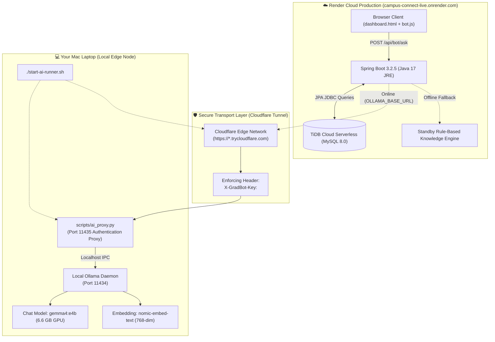

# 💻 Local AI Runner & Hybrid Cloud Architecture Guide
## Bridging Local Mac GPU (`gemma4:e4b`) to Render Production (`campus-connect-live.onrender.com`)

> **Live Production Deployment:** [https://campus-connect-live.onrender.com](https://campus-connect-live.onrender.com)  
> **Database:** TiDB Cloud Serverless (Distributed MySQL-compatible)  
> **Local AI Runner Command:** `./start-ai-runner.sh`

---

## 1. Executive Summary & Problem Statement

### The Cloud GPU Challenge
Modern Large Language Models like **Google Gemma 4 (`gemma4:e4b`)** (6.6 GB) and high-density vector embedding models like **Nomic Embed Text** require substantial memory and compute hardware:
- Cloud GPU virtual machines (e.g. AWS `g4dn.xlarge` or GCP `a2-highgpu`) typically cost **\$50–\$200/month**.
- Free/starter cloud app platforms like **Render Starter Tier** provide 512 MB to 2 GB RAM with shared vCPUs, which cannot execute local 7B LLM parameter models without severe Out-Of-Memory (OOM) crashes.

### The Hybrid Cloud Solution
**Campus Connect** implements a **Hybrid Cloud Architecture**:
1. **Cloud Production Host (Render):** Hosts the main Java 17 / Spring Boot backend, STOMP WebSockets, static HTML5/ES6 SPA frontend, and connects to **TiDB Cloud**.
2. **Edge Hardware Accelerator (Your Mac Laptop):** Runs the local Ollama daemon leveraging your Mac's Apple Silicon unified memory / GPU to run `gemma4:e4b` and `nomic-embed-text` with zero cloud compute cost.
3. **Zero-Trust Encrypted Tunnel (Cloudflare):** A one-command terminal script (`./start-ai-runner.sh`) spins up an authenticated local reverse proxy enforcing a shared secret token (`X-GradBot-Key`) and connects via an ephemeral HTTPS Cloudflare Tunnel directly to Render.
4. **Graceful Standby Fallback:** When your laptop is closed or offline, Render's backend automatically falls back to smart rule-based campus data without failing or throwing 500 errors.

---

## 2. Hybrid Architecture Topology



---

## 3. Step-by-Step Quickstart: Running on your Laptop

### Step 1: Start the Local AI Runner
Open a terminal in your project directory on your Mac and run:
```bash
./start-ai-runner.sh
```

The script will automatically:
1. Verify that **Ollama** is running on your Mac.
2. Verify models `gemma4:e4b` and `nomic-embed-text` are ready.
3. Check and use your shared secret from `.env.ai-runner` (or generate a secure random 48-character token if first time).
4. Launch the local Python reverse proxy on port `11435` enforcing the `X-GradBot-Key` header.
5. Create a secure Cloudflare HTTPS Tunnel and print your public URL.
6. Verify the tunnel end-to-end with an automated health ping.

### Step 2: Configure Render Environment Variables
In your [Render Dashboard](https://dashboard.render.com):
1. Navigate to your **Campus Connect** Web Service.
2. Click on the **Environment** tab.
3. Update or add these two environment variables:

| Environment Variable | Value | Description |
| :--- | :--- | :--- |
| `OLLAMA_BASE_URL` | `https://<your-tunnel-subdomain>.trycloudflare.com` | Public Cloudflare tunnel URL printed by `./start-ai-runner.sh` |
| `OLLAMA_AUTH_TOKEN` | `<your-token-from-.env.ai-runner>` | Shared secret token enforcing access control |

*(Optional: If you add `RENDER_API_KEY` and `RENDER_SERVICE_ID` to `.env.ai-runner`, the script automatically syncs Render's environment variables via the Render REST API on every startup!)*

### Step 3: Test on Render Frontend
1. Open [`https://campus-connect-live.onrender.com`](https://campus-connect-live.onrender.com).
2. Click the floating **GradBot** button in the bottom right.
3. Check health status at `https://campus-connect-live.onrender.com/api/bot/health`:
   ```json
   {
     "status": "ONLINE",
     "model": "gemma4:e4b",
     "embeddingModel": "nomic-embed-text",
     "mode": "Mac AI Runner Connected (gemma4:e4b)"
   }
   ```
4. Ask any question (e.g. *"What is the MCA syllabus?"* or *"Any upcoming workshops?"*) — the inference will run on your local Mac GPU and stream the answer to the live website!

---

## 4. Security & Zero-Trust Verification

To protect your home network and laptop hardware from unauthorized access:
- **No Inbound Open Ports:** Cloudflare Tunnel uses outbound connections (`cloudflared -> Cloudflare edge`). Your home router does **not** need port forwarding or public IP exposure.
- **Shared Secret Enforcement:** All requests routed from Render must supply the header `X-GradBot-Key: <secret>`.
- **401 Unauthorized Rejection:** If an internet crawler discovers the `.trycloudflare.com` URL and sends a request without the correct key, `scripts/ai_proxy.py` immediately responds with `401 Unauthorized` before reaching Ollama.

---

## 5. Interview Pitch & Architectural Highlights

When explaining this architecture in a technical interview:

> *"For Campus Connect, I wanted our AI assistant (GradBot) to leverage high-capability local models like Gemma 4 (6.6 GB) and Nomic Embed Text without incurring the high \$100+/month costs of persistent cloud GPU instances on AWS or GCP.*
>
> *I designed a **Hybrid Edge-Cloud Architecture**: our Java 17 / Spring Boot backend and TiDB database run in production on Render. To power inference, I built an automated edge runner (`./start-ai-runner.sh`) that exposes my laptop's Apple Silicon GPU to Render via an outbound Cloudflare tunnel with a zero-trust shared-secret proxy.*
>
> *Crucially, I designed the system with the **Circuit Breaker & Graceful Degradation pattern**: if my laptop goes offline, Render's backend detects the state via health checks and automatically falls back to an in-memory rule-based campus knowledge engine so the platform remains 100% functional 24/7."*
