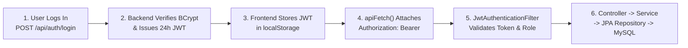

# 🎯 Campus Connect — Complete Interview Guide & Q&A

This guide is structured to help you confidently explain **Campus Connect** in technical interviews, project viva/reviews, and system design discussions — from a **30-second elevator pitch** to a **3-minute deep-dive walkthrough**, followed by **25+ frequently asked interview questions with model answers**.

---

## 1. ⏱️ The 30-Second Elevator Pitch (Opening Hook)

> *"I built **Campus Connect**, a full-stack, real-time campus networking and career platform for BVICAM that connects **Students**, **Alumni**, and **College Administration** in a single secure ecosystem.*
>
> *Normally, colleges rely on fragmented WhatsApp groups, spreadsheets, and email chains for placement referrals, alumni networking, and event RSVPs. Campus Connect replaces that with a centralized platform built on **Java 17, Spring Boot 3.2, Spring Security with stateless JWTs, Spring Data JPA (MySQL/TiDB), and STOMP over SockJS WebSockets**.*
>
> *It features real-time 1-on-1 and campus-wide chat with typing indicators and read receipts, an automated bilingual (English + Hinglish) profanity moderation engine with a progressive 3-tier strike/ban system, an Alumni Job & Referral board, Event RSVP management, and an Admin workspace with Apache POI bulk Excel onboarding and SMTP email broadcasting. It is containerized with Docker Compose and deployed live on Render with TiDB Cloud."*

---

## 2. 🗣️ The 2–3 Minute Structured Project Walkthrough ("Tell Me About Your Project")

When an interviewer says **"Walk me through your project from start to finish"**, follow this **5-part framework (Problem → Roles → Architecture → Key Engineering Highlights → Deployment)**:

### Part 1: The Problem & Motivation (20 seconds)
- "In most colleges, communication between current students, alumni, and faculty is scattered across unofficial WhatsApp groups and emails. Students miss out on alumni job referrals, alumni have no structured directory to mentor juniors, and admins manually create accounts or track event attendance in spreadsheets."
- "I designed **Campus Connect** to bring all three stakeholders into one role-based platform."

### Part 2: Role-Based Access Control — Who Does What (30 seconds)
- "The platform enforces **Role-Based Access Control (RBAC)** across three roles (`STUDENT`, `ALUMNI`, `ADMIN`):
  - **Students** can share posts on the Campus Wall, search the Student/Alumni Directory by batch/department/role, apply for jobs and referrals, RSVP to campus events, and chat 1-on-1 with seniors or alumni.
  - **Alumni** have all student capabilities plus the ability to publish and manage **Job Openings (`JOB`)** and **Referral Opportunities (`REFERRAL`)** on the career board.
  - **Admins** have a dedicated **Admin Portal** (`/api/admin/**`) to create/edit/delete users, bulk-onboard hundreds of accounts via Excel (`.xlsx`) or CSV upload, moderate posts, create/edit events and inspect RSVP participant lists, post or edit jobs/referrals, review student feedback, and send campus-wide email broadcasts."

### Part 3: Technical Architecture & Request Flow (45 seconds)
- "**Frontend:** I built a lightweight, modular Single-Page Application (SPA) shell (`dashboard.html` + `dashboard-main.js`) using Vanilla ES6 JavaScript and Bootstrap 5. Instead of loading a heavy framework bundle, `dashboard-main.js` dynamically fetches HTML partial templates (`/components/*.html`) and initializes dedicated JS modules (`wall.js`, `chat.js`, `jobs.js`, `events.js`, `directory.js`, `admin.js`). All API requests go through a centralized `apiFetch()` wrapper (`api.js`) that automatically injects the JWT Bearer token."
- "**Backend:** The backend follows a clean **5-layer Spring Boot 3.2 architecture**:
  1. **Security Filter Layer** (`SecurityConfig` + `JwtAuthenticationFilter`) — intercepts every request, validates the HMAC-SHA256 JWT (`JwtUtil`), and populates the stateless `SecurityContextHolder`.
  2. **Controller Layer** — 10 REST controllers + STOMP `@MessageMapping` handlers.
  3. **Service Layer** — encapsulates business rules like profanity filtering, strike escalation, event RSVP toggling, and async email delivery.
  4. **Repository Layer** — 9 Spring Data JPA repositories with custom JPQL and derived queries.
  5. **Database Layer** — 11 normalized relational tables in MySQL 8.0 locally and TiDB Cloud in production."

### Part 4: Three Standout Engineering Features (45 seconds)
1. **Real-Time Dual-Mode Chat with STOMP WebSockets (`ChatController`, `WebSocketConfig`):**
   - "Supports both a public campus lounge (`/topic/public`) and private 1-on-1 messaging (`/user/{username}/queue/messages`). Private messages are persisted in MySQL with `SENT`, `DELIVERED`, and `READ` statuses, and the UI shows real-time typing indicators (`/queue/typing`) and live unread badge counts."
2. **Automated Bilingual Content Moderation & Strike System (`ProfanityFilterService`, `UserModerationService`):**
   - "Every wall post and comment is scanned before persistence against both English and Hindi/Hinglish profanity dictionaries using normalized regex word-boundary matching that catches character stretching and obfuscation. If flagged, the content is blocked (`HTTP 400`) and the user's `violationCount` increments: Strikes 1–2 issue a warning, Strikes 3–4 trigger an automatic **24-hour temporary ban** (`banExpiresAt`), and Strike 5+ enforces a **7-day suspension**."
3. **Bulk Excel/CSV Onboarding via Apache POI (`AdminController`):**
   - "Admins can upload a single `.xlsx` or `.csv` spreadsheet to onboard an entire incoming batch. The backend detects the file format, parses rows via Apache POI (`WorkbookFactory`) or `BufferedReader`, skips duplicates safely (`existsByEmail`), hashes passwords with BCrypt, and auto-creates missing Department records."

### Part 5: DevOps & Deployment (15 seconds)
- "For local development, I containerized the entire stack using a multi-stage `Dockerfile` and `docker-compose.yml` running `campus-connect-app` (JDK 17) and `campus-connect-mysql` (MySQL 8.0 with healthchecks and persistent volumes). In production, it is deployed on **Render** connected to a serverless **TiDB Cloud** cluster at `https://campus-connect-live.onrender.com`."

---

## 3. 🧠 Visual Architecture Flow (To Keep in Mind During Interviews)



---

## 4. ❓ Top 25 Interview Questions & Model Answers

### Category A: Architecture & Design Decisions

#### Q1. Why did you choose a modular Vanilla JS SPA (`dashboard-main.js`) instead of React or Angular?
**Answer:**
> "I wanted zero build-step complexity, instant startup inside Spring Boot's static resource handler, and full control over DOM lifecycle and WebSocket state. By building a lightweight component loader in [`dashboard-main.js`](../src/main/resources/static/js/dashboard-main.js) that fetches HTML fragments (`/components/*.html`) on demand and pairs each view with an ES6 module (`wall.js`, `chat.js`, `jobs.js`, `admin.js`), the entire application is served as a single unified Spring Boot artifact (`.jar`) with no separate Node.js build pipeline or CORS overhead."

#### Q2. How does your SPA handle modal dialogs and CSS stacking contexts when loading HTML components dynamically?
**Answer:**
> "When HTML fragments like `events.html`, `jobs.html`, or `admin.html` are injected into `#main-content`, any CSS `transform`, `animation`, or `backdrop-filter` on parent containers creates a new CSS stacking context. That traps `position: fixed` modals behind Bootstrap's `.modal-backdrop` (`z-index: 1050`), making the screen appear frozen. I solved this in [`dashboard-main.js`](../src/main/resources/static/js/dashboard-main.js) by automatically hoisting all `.modal` elements out of `#main-content` directly onto `document.body` during component load, cleaning up stale instances before re-mounting, and removing `backdrop-filter` from `#main-content`."

#### Q3. Walk me through what happens on the backend when a user logs in and makes an authenticated API request.
**Answer:**
> 1. **Login (`POST /api/auth/login`):** [`AuthController`](../src/main/java/com/bvicam/campusconnect/controller/AuthController.java) passes the email and password to Spring Security's `AuthenticationManager`, which uses [`CustomUserDetailsService`](../src/main/java/com/bvicam/campusconnect/service/CustomUserDetailsService.java) to load the `User` from MySQL and `BCryptPasswordEncoder` to verify the password hash.
> 2. **Token Generation:** On match, [`JwtUtil`](../src/main/java/com/bvicam/campusconnect/util/JwtUtil.java) signs a JWT with `HS256` containing `sub` (email), `iat`, and `exp` (24 hours), returning `AuthResponse` (`token`, `email`, `name`, `role`, `id`).
> 3. **Subsequent Requests:** The frontend helper [`apiFetch()`](../src/main/resources/static/js/utils/api.js) attaches `Authorization: Bearer <token>`.
> 4. **Filter Validation:** [`JwtAuthenticationFilter`](../src/main/java/com/bvicam/campusconnect/config/JwtAuthenticationFilter.java) (extending `OncePerRequestFilter`) extracts the token, verifies its signature and expiration, loads the user's `ROLE_<ROLE>` authority, and sets the `UsernamePasswordAuthenticationToken` in `SecurityContextHolder`.Because `SessionCreationPolicy.STATELESS` is configured, no `HttpSession` is ever created on the server.

---

### Category B: Spring Security, JWT & RBAC

#### Q4. Why did you use Stateless JWT Authentication instead of traditional server-side sessions (`JSESSIONID`)?
**Answer:**
> "Stateless JWT authentication keeps the Spring Boot server completely free of session state in memory. Every HTTP request carries its own signed proof of identity. This makes horizontal scaling across multiple containers trivial (no sticky sessions or Redis session store required), works cleanly with REST APIs (`apiFetch`), and avoids CSRF issues associated with cookie-based sessions."

#### Q5. How is Role-Based Access Control (RBAC) enforced at both the URL level and the business-logic level?
**Answer:**
> "I enforce RBAC at two layers:
> 1. **Filter Chain Level ([`SecurityConfig.java`](../src/main/java/com/bvicam/campusconnect/config/SecurityConfig.java)):**
>    - `/api/auth/**`, `/ws/**`, `/uploads/**`, and static assets are `permitAll()`.
>    - `/api/admin/**` requires `.hasRole("ADMIN")` (Spring Security checks for the `ROLE_ADMIN` authority).
>    - All other `/api/**` routes require `.authenticated()`.
> 2. **Controller / Service Level:**
>    - In [`JobController`](../src/main/java/com/bvicam/campusconnect/controller/JobController.java), creating a job/referral (`POST /api/jobs/create`) verifies that the caller's role is `ALUMNI` or `ADMIN` (rejecting `STUDENT` with `403 Forbidden`), while updating (`PUT /api/jobs/{id}`) or deleting (`DELETE /api/jobs/{id}`) verifies that the caller is **either** the original `postedBy` author **or** an `ADMIN`.
>    - In [`EventService`](../src/main/java/com/bvicam/campusconnect/service/EventService.java), creating, editing, or deleting events verifies that the caller has `Role.ADMIN`."

#### Q6. How are passwords stored in the database? Can an Admin see a user's plain-text password?
**Answer:**
> "Passwords are never stored in plain text. Every password—whether registered via `/api/auth/register`, seeded in [`DataSeeder`](../src/main/java/com/bvicam/campusconnect/config/DataSeeder.java), created by an Admin, or bulk-imported via Excel—is hashed using `BCryptPasswordEncoder` (which automatically generates a random per-password salt). Even if the database is compromised or an Admin inspects the `users` table, only the irreversible BCrypt hash (`$2a$10$...`) exists. Additionally, `User.password` is annotated with `@JsonIgnore` so password hashes are never serialized in API responses."

---

### Category C: Real-Time WebSockets & Chat System

#### Q7. How did you implement both Global Chat and 1-on-1 Private Chat using WebSockets?
**Answer:**
> "I used **Spring WebSocket with STOMP over SockJS** ([`WebSocketConfig.java`](../src/main/java/com/bvicam/campusconnect/config/WebSocketConfig.java) & [`ChatController.java`](../src/main/java/com/bvicam/campusconnect/controller/ChatController.java)):
> - **Handshake Endpoint:** `/ws` with `.withSockJS()` fallback in case a campus firewall blocks raw WebSocket upgrades.
> - **Global Chat:** Clients send frames to `/app/chat.sendMessage`, which maps to `@MessageMapping("/chat.sendMessage")` and `@SendTo("/topic/public")`. Every connected client subscribed to `/topic/public` receives the broadcast immediately.
> - **1-on-1 Private Chat:** Clients send frames to `/app/chat.private`. [`ChatController`](../src/main/java/com/bvicam/campusconnect/controller/ChatController.java) saves a [`PrivateMessage`](../src/main/java/com/bvicam/campusconnect/entity/PrivateMessage.java) entity in MySQL with `status = SENT` and uses `SimpMessagingTemplate.convertAndSendToUser(recipient, "/queue/messages", savedMsg)` to route the message exclusively to `/user/{recipient}/queue/messages`."

#### Q8. How do typing indicators, unread message counts, and read receipts (`READ` status) work in your chat module?
**Answer:**
> - **Typing Indicators:** When a user types in a 1-on-1 chat, [`chat.js`](../src/main/resources/static/js/modules/chat.js) sends a lightweight STOMP payload (`{sender, recipient, typing: true}`) to `/app/chat.typing`. The backend immediately forwards it to `/user/{recipient}/queue/typing` without touching the database, and the recipient's UI displays `'typing...'` with a debounced auto-clear timer.
> - **Unread Counts:** `GET /api/messages/unread-counts/{email}` runs a custom grouped JPQL query (`SELECT m.senderName, COUNT(m) FROM PrivateMessage m WHERE m.recipientName = :recipient AND m.status <> 'READ' GROUP BY m.senderName`) to return a map of `{senderEmail: unreadCount}` in a single database query.
> - **Read Receipts:** When a user opens a conversation with `sender`, the frontend calls `PUT /api/messages/mark-read/{sender}/{recipient}`, which executes an `@Modifying @Transactional` bulk `UPDATE` query setting `status = 'READ'` for all unread messages in that thread."

---

### Category D: Content Moderation & Business Logic

#### Q9. Explain how your automated Profanity Filter and progressive Strike/Ban system works.
**Answer:**
> "When a user submits a post (`POST /api/posts/create`) or comment (`POST /api/posts/{id}/comment`), [`PostService`](../src/main/java/com/bvicam/campusconnect/service/PostService.java) passes the text to [`ProfanityFilterService.containsProfanity(text)`](../src/main/java/com/bvicam/campusconnect/service/ProfanityFilterService.java):
> 1. **Normalization:** It converts the text to lowercase, strips punctuation/special symbols (`[^a-zA-Z0-9\\s]`), and collapses repeated characters (`(.)\\1+` → `$1`) so tricks like `'f u c k'` or `'fuuuuck'` or Hinglish variants are caught.
> 2. **Word-Boundary Regex Matching:** It checks against curated English and Hindi/Hinglish word sets using `\\b` word boundaries to avoid false positives on normal words (the Scunthorpe problem).
> 3. **Progressive Strike Escalation ([`UserModerationService`](../src/main/java/com/bvicam/campusconnect/service/UserModerationService.java)):**
>    - First, `checkBanStatus(user)` checks if `user.isBanned()` is true. If `LocalDateTime.now().isAfter(user.getBanExpiresAt())`, it automatically lifts the expired ban; otherwise it blocks the post.
>    - If profanity is detected, `handleViolation(user)` increments `violationCount` and saves it immediately:
>      - **Strikes 1–2:** Throws a warning (`⚠️ Warning (Strike X/3): Your post contains inappropriate language`).
>      - **Strikes 3–4:** Sets `isBanned = true` and `banExpiresAt = now + 24 hours`.
>      - **Strike 5+:** Sets `isBanned = true` and `banExpiresAt = now + 7 days`."

#### Q10. If [`PostService.createPost()`](../src/main/java/com/bvicam/campusconnect/service/PostService.java) throws a `RuntimeException` when profanity is detected, how do you make sure the user's new strike count isn't rolled back by the database transaction?
**Answer:**
> "Great question! In [`PostService`](../src/main/java/com/bvicam/campusconnect/service/PostService.java), `createPost()` and `addComment()` run profanity detection and call `moderationService.handleViolation(user)` **before** persisting the post, and `handleViolation()` immediately calls `userRepository.save(user)` in its own repository transaction before throwing the `RuntimeException`. That guarantees the strike increment and `banExpiresAt` timestamp are committed to the `users` table even though the offending post itself is rejected and never saved."

---

### Category E: Database Design, JPA & Performance

#### Q11. How is the database schema designed, and what are the main relationships between entities?
**Answer:**
> "The database has **11 tables** generated from 9 JPA `@Entity` classes plus 2 join/collection tables:
> - **`users` ↔ `departments`:** Many-to-One (`users.department_id` → `departments.id`).
> - **`users` ↔ `posts`:** One-to-Many (`posts.user_id` → `users.id`), plus `@ElementCollection` `post_attachments` (`post_id`, `file_url`) and `@ManyToMany` `post_likes` (`post_id`, `user_id`) so each user can like a post at most once.
> - **`posts` ↔ `comments`:** One-to-Many (`comments.post_id` → `posts.id`, `comments.user_id` → `users.id`) with `CascadeType.ALL` and `orphanRemoval = true`.
> - **`events` ↔ `users`:** Many-to-Many via `event_participants` (`event_id`, `user_id`) tracking event RSVPs.
> - **`jobs` ↔ `users`:** Many-to-One (`jobs.user_id` → `users.id`) linking each `JOB` or `REFERRAL` to its creator.
> - **`private_messages`, `notifications`, `feedbacks`:** Track 1-on-1 messages, in-app alerts, and student feedback."

#### Q12. How did you prevent infinite JSON recursion (`StackOverflowError`) when serializing bidirectional JPA relationships like `Event ↔ User` or `Post ↔ Comment`?
**Answer:**
> "I used two complementary techniques:
> 1. **`@JsonIgnore` on Entity Collections/Fields:** On [`Event.attendees`](../src/main/java/com/bvicam/campusconnect/entity/Event.java), [`Comment.post`](../src/main/java/com/bvicam/campusconnect/entity/Comment.java), and [`User.password`](../src/main/java/com/bvicam/campusconnect/entity/User.java), I added `@JsonIgnore` so Jackson doesn't endlessly traverse circular object graphs.
> 2. **Dedicated DTO Projections:** For example, [`EventService`](../src/main/java/com/bvicam/campusconnect/service/EventService.java) maps each `Event` entity to an [`EventDTO`](../src/main/java/com/bvicam/campusconnect/dto/EventDTO.java) containing scalar fields plus precomputed `participantCount` (`attendees.size()`) and `isJoined` (`attendees.contains(currentUser)`), and [`NotificationController`](../src/main/java/com/bvicam/campusconnect/controller/NotificationController.java) maps `Notification` entities to [`NotificationDto`](../src/main/java/com/bvicam/campusconnect/dto/NotificationDto.java)."

#### Q13. How does the Multi-Filter Directory Search (`GET /api/users/search`) work when some filters are optional?
**Answer:**
> "In [`UserRepository.java`](../src/main/java/com/bvicam/campusconnect/repository/UserRepository.java), I wrote a single flexible JPQL query where each filter parameter (`query`, `role`, `department`, `batchYear`) is nullable:
> ```sql
> SELECT u FROM User u LEFT JOIN u.department d
> WHERE (:query IS NULL OR LOWER(u.name) LIKE LOWER(CONCAT('%', :query, '%'))
>        OR LOWER(u.email) LIKE LOWER(CONCAT('%', :query, '%')))
>   AND (:role IS NULL OR u.role = :role)
>   AND (:department IS NULL OR LOWER(d.name) = LOWER(:department))
>   AND (:batchYear IS NULL OR u.batchYear = :batchYear)
> ```
> Important detail: I used `LEFT JOIN u.department d` instead of an inner join so users who don't have a department assigned yet are still returned when the department filter is not active."

---

### Category F: File Uploads, Bulk Onboarding & Email Broadcasts

#### Q14. How does the Admin Bulk User Upload (`/api/admin/upload-users`) handle both Excel (`.xlsx`) and `.csv` files?
**Answer:**
> "[`AdminController.uploadUsersFile()`](../src/main/java/com/bvicam/campusconnect/controller/AdminController.java) inspects the uploaded filename:
> - If it ends with `.xlsx` or `.xls`, it delegates to `parseExcel()` using **Apache POI's `WorkbookFactory.create(InputStream)`** and `DataFormatter` to safely read numeric cells (like batch years or roll numbers) as strings.
> - If it ends with `.csv`, it delegates to `parseCsv()` using `BufferedReader`.
> - For each row (`Name, Email, Password, Role, BatchYear, Department`), `processSingleUser()` trims fields, checks `userRepository.existsByEmail(email)` to skip existing accounts idempotently, resolves or auto-creates the `Department` entity, hashes the password with BCrypt, and returns a summary count of created vs. skipped records."

#### Q15. Why did you annotate `EmailService.sendEmail()` with `@Async`?
**Answer:**
> "When an Admin sends a campus-wide broadcast (`POST /api/admin/broadcast`), the system iterates over every registered user in the database. External SMTP handshakes with `smtp.gmail.com:587` take 500ms–2s per email. By enabling `@EnableAsync` in [`CampusConnectApplication`](../src/main/java/com/bvicam/campusconnect/CampusConnectApplication.java) and marking [`EmailService.sendEmail()`](../src/main/java/com/bvicam/campusconnect/service/EmailService.java) with `@Async`, each SMTP call is offloaded to a background thread pool while in-app notifications are saved immediately, so the Admin's HTTP request returns in milliseconds instead of timing out."

---

### Category G: Docker, Cloud Deployment & Production Challenges

#### Q16. How did you containerize the project with Docker, and why did you use a multi-stage `Dockerfile`?
**Answer:**
> "In [`Dockerfile`](../Dockerfile), I used a **two-stage build**:
> 1. **Stage 1 (`maven:3.9.6-eclipse-temurin-17`):** Copies `pom.xml` first and runs `mvn dependency:go-offline` so Maven dependencies are cached in a separate Docker layer, then compiles the source code into a fat JAR (`mvn clean package -DskipTests`).
> 2. **Stage 2 (`eclipse-temurin:17-jre-jammy`):** Copies only the compiled `.jar` into a slim JRE image. This keeps the production container image small, secure (no compiler or source code in production), and fast to deploy on Render.
> In [`docker-compose.yml`](../docker-compose.yml), `campus-connect-mysql` runs with a `mysqladmin ping` healthcheck, and `campus-connect-app` uses `depends_on: condition: service_healthy` so Spring Boot only starts after MySQL is ready to accept connections."

#### Q17. What happens if this application is scaled to multiple server instances in production? What would you change?
**Answer:**
> "Great system design question! Right now, the JWT authentication layer and TiDB Cloud database are already stateless and horizontally scalable. However, two components would need upgrading for multi-instance scaling:
> 1. **WebSocket Broker:** Currently `WebSocketConfig` uses Spring's in-memory simple broker (`enableSimpleBroker("/topic", "/queue")`). If User A is connected to Instance 1 and User B is connected to Instance 2, an in-memory broker on Instance 1 wouldn't reach User B. To scale horizontally, I would switch to `enableStompBrokerRelay` backed by **RabbitMQ** or **Redis Pub/Sub**.
> 2. **Uploaded Media (`./uploads`):** Currently files are stored on the container filesystem (`uploads/`). For multi-instance or ephemeral cloud containers, I would replace `Files.copy()` in `PostService` and `UserController` with **AWS S3** or **Cloudinary** object storage."

---

## 5. 💡 Quick Cheat-Sheet of Key Numbers & Facts for Your Interview

| Metric / Aspect | Value / Detail |
| :--- | :--- |
| **Live Production URL** | [`https://campus-connect-live.onrender.com`](https://campus-connect-live.onrender.com) |
| **Java & Spring Boot Version** | Java 17 + Spring Boot `3.2.5` |
| **Authentication Mechanism** | Stateless JWT (`HS256`, `24-hour` expiry) + `BCryptPasswordEncoder` |
| **User Roles** | `STUDENT`, `ALUMNI`, `ADMIN` |
| **Database Tables** | `11` tables (MySQL 8.0 locally / TiDB Cloud Serverless in production) |
| **Real-Time Protocol** | STOMP over SockJS WebSockets (`/ws`, `/topic/public`, `/user/{username}/queue/messages`) |
| **Content Moderation** | Bilingual (English + Hindi/Hinglish) regex filter + 3-tier progressive strike/ban system (`Warning` → `24h Ban` → `7d Ban`) |
| **Bulk Onboarding** | Apache POI `5.2.5` (`.xlsx` / `.xls`) + CSV parser (`POST /api/admin/upload-users`) |
| **File Attachment Limits** | Up to `4` files per Wall post, `10 MB` max size (`spring.servlet.multipart.max-file-size=10MB`) |
