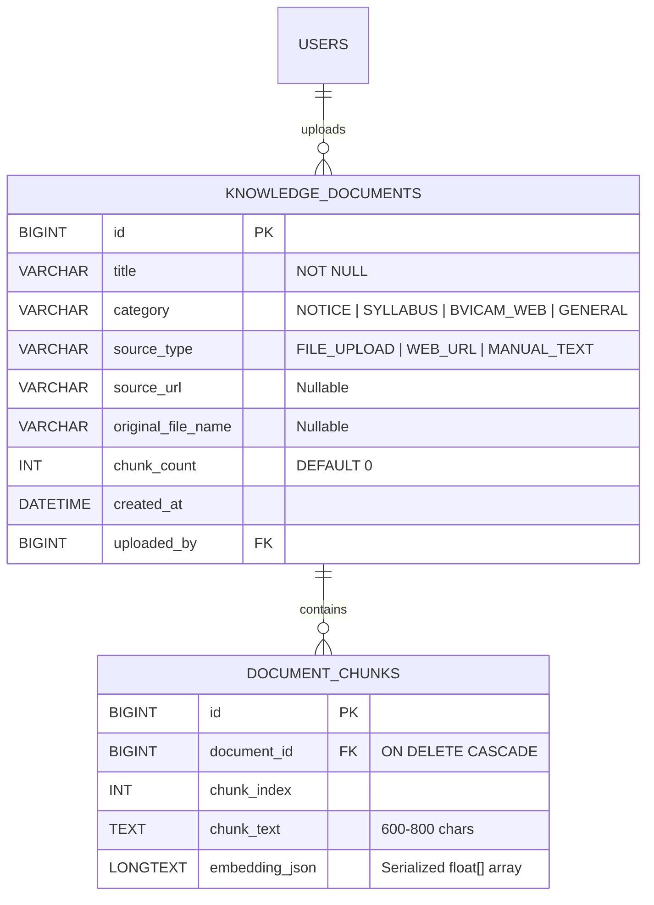

# 📋 Formal Feature Specification: AI Chatbot & RAG Knowledge Engine (GradBot)

- **Feature Name:** BVICAM AI Chatbot & RAG Knowledge Engine
- **Spec ID:** `SPEC-AI-001`
- **Status:** APPROVED & READY FOR IMPLEMENTATION
- **Created:** 2026-10-27
- **Target Release:** Campus Connect (GradLink) v1.2.0
- **Authors:** Campus Connect Core Architecture Team
- **Related ADR:** [ADR-001: AI Chatbot & RAG Knowledge Engine](../adr/ADR-001-ai-chatbot-rag-knowledge-engine.md)
- **Work Tickets:** [Tickets CC-AI-01 through CC-AI-06](../tickets/ai-chatbot-vertical-slices.md)

---

## 1. Problem Statement

GradLink (Campus Connect) currently relies on a simplistic, hardcoded pattern matcher in [`BotController.java`](../../src/main/java/com/bvicam/campusconnect/controller/BotController.java) (`POST /api/bot/ask`). This legacy bot suffers from major systemic shortcomings:
1. **Static & Fragile String Matching:** It can only answer if a prompt contains exact keywords (`"placement"`, `"batch"`, `"event"`). Any variation, compound query, or natural question (e.g., *"When is the mid-term exam?"*, *"How do I apply for MCA admission?"*, or *"Which companies visited last year?"*) yields an unhelpful fallback error.
2. **Disconnected from College Knowledge:** Official institute policies, syllabi, circulars, exam notices, and website content from **`bvicam.in`** are completely unavailable to students through the platform.
3. **No Administrative Ingestion Pipeline:** College administration has no way to upload new notices, guidelines, or circulars to the assistant without modifying Java source code and rebuilding the entire backend.
4. **No Real-Time Synthesis:** The bot cannot summarize live campus events or job referrals in natural language alongside official college notices.
5. **Lack of Trust & Transparency:** There is no source attribution or citation mechanism, making it impossible for students to verify where an answer originated.

---

## 2. Solution Overview

We introduce **GradBot AI** — a **Hybrid Retrieval-Augmented Generation (RAG) and Dynamic Database Synthesis Engine** embedded within the Spring Boot 3.2 backend, powered by a local **Ollama** runtime running Google's **`gemma4:e4b`** model (6.6 GB) on Apple Silicon, with dense vector embeddings via **`nomic-embed-text`**.

```mermaid
flowchart TD
    subgraph Users["Campus Stakeholders (Browser)"]
        Student["🎓 Student\n(Queries notices, syllabus, events)"]
        Alumni["💼 Alumni\n(Queries referrals, mentors, meets)"]
        Admin["🏛️ Admin\n(Uploads notices, indexes URLs, chats)"]
    end

    subgraph Presentation["Presentation & API Layer"]
        BotUI["GradBot Widget\n(dashboard.html + bot.js)"]
        AdminUI["Admin Knowledge Sub-tab\n(admin.html + admin.js)"]
        BotCtrl["BotController\nPOST /api/bot/ask"]
        AdminCtrl["AdminKnowledgeController\nPOST/DELETE /api/admin/knowledge/*"]
    end

    subgraph Service["Application & Intelligence Layer"]
        RAG["CampusAiService\n(Hybrid RAG Coordinator)"]
        Ingest["KnowledgeIngestionService\n(PDFBox + Jsoup + Chunker)"]
        Ollama["OllamaClientService\n(HTTP to localhost:11434)"]
    end

    subgraph Persistence["Storage & Database Layer"]
        DBDocs[("knowledge_documents\n& document_chunks (MySQL)")]
        LiveDB[("Live JPA Repositories\n(Events, Jobs, Users)")]
    end

    subgraph AI["Local Ollama Daemon"]
        Gemma["gemma4:e4b\n(Generative Reasoning LLM)"]
        Embedder["nomic-embed-text\n(Vector Embeddings)"]
    end

    Student & Alumni & Admin --> BotUI
    Admin --> AdminUI
    BotUI --> BotCtrl
    AdminUI --> AdminCtrl

    BotCtrl --> RAG
    AdminCtrl --> Ingest

    Ingest -->|Vectorize Chunks| Ollama
    Ingest -->|Persist Metadata & Chunks| DBDocs

    RAG -->|Vector Search (Cosine)| DBDocs
    RAG -->|Fetch Real-time State| LiveDB
    RAG -->|Embed Query & Chat Synthesis| Ollama

    Ollama <--> Gemma & Embedder
```

### Key Solution Pillars:
1. **Three-Tier Knowledge Synthesis:**
   - **Tier 1 (Admin Documents):** Notices, circulars, and syllabi uploaded by Admins via PDF or plain text.
   - **Tier 2 (Official BVICAM Website):** Scraped and indexed web pages from `bvicam.in` (admissions, faculty directory, about BVICAM).
   - **Tier 3 (Live GradLink Domain Context):** Real-time database queries to `EventRepository`, `JobRepository`, and `UserRepository` dynamically injected at inference time.
2. **Local-First & Zero-Cost Inference:** Utilizes Apple Silicon hardware acceleration via local Ollama (`http://localhost:11434`) with zero cloud token consumption and complete data confidentiality.
3. **Source-Attributed Markdown Outputs:** Every generative response cites referenced notices or web URLs using interactive badge tags.
4. **Administrative Self-Service:** Admins have full CRUD capability over the AI knowledge base in [`admin.html`](../../src/main/resources/static/components/admin.html).

---

## 3. Extensive User Stories & Acceptance Criteria

### User Persona 1: Student (`Role.STUDENT`)

#### US-S01: Natural-Language Academic & Exam Inquiries
- **As a** student preparing for semester exams,
- **I want to** ask GradBot natural questions about syllabus modules, examination schedules, and college circulars,
- **So that** I do not have to hunt through scattered WhatsApp groups or physical bulletin boards.
- **Acceptance Criteria (EARS / Gherkin):**
  - **Given** an Admin has uploaded the *"MCA Semester 3 Examination Circular"* PDF into the knowledge base,
  - **When** the student asks *"When do MCA 3rd semester lab exams start?"*,
  - **Then** the system retrieves the matching chunks via vector cosine similarity, passes them to `gemma4:e4b`, and returns the precise start date and time.
  - **And** the message includes an attribution pill: `[Source: Notice - MCA Semester 3 Examination Circular]`.

#### US-S02: Dynamic Campus Events Inquiries
- **As a** student seeking extracurricular activities,
- **I want to** ask GradBot what workshops, seminars, or hackathons are coming up this week,
- **So that** I can register before RSVP limits are reached.
- **Acceptance Criteria:**
  - **Given** an event titled *"AI & Cloud Workshop"* is scheduled in MySQL for tomorrow at 2:00 PM,
  - **When** the student asks *"Are there any workshops scheduled for tomorrow?"*,
  - **Then** `CampusAiService` dynamically queries `EventRepository.findByDateTimeAfterOrderByDateTimeAsc()`, injects the event details into the LLM prompt, and replies with title, venue, and a direct prompt to RSVP on the Events tab.

#### US-S03: Alumni & Career Referral Discovery
- **As a** final-year student seeking career opportunities,
- **I want to** ask GradBot which alumni work in my target companies (e.g. Microsoft, TCS, Nagarro),
- **So that** I can reach out to them for a referral.
- **Acceptance Criteria:**
  - **Given** registered alumni users have `currentCompany = 'Microsoft'` or active referrals in `JobRepository`,
  - **When** the student types *"Which alumni work at Microsoft or have active referrals?"*,
  - **Then** the bot identifies the alumni names and active referral titles from the live database and suggests opening 1-on-1 chat in the Directory tab.

---

### User Persona 2: Alumni (`Role.ALUMNI`)

#### US-A01: Campus Reunion & Alumni Meet Inquiries
- **As an** alumnus visiting the platform,
- **I want to** ask GradBot when the next annual alumni meet or guest lecture is scheduled,
- **So that** I can plan my travel and RSVP.
- **Acceptance Criteria:**
  - **Given** an event with type `ALUMNI_MEET` exists in the database,
  - **When** the alumnus asks *"When is the next BVICAM alumni reunion?"*,
  - **Then** GradBot provides the exact date, venue, and organizer details synthesized cleanly in Markdown.

#### US-A02: Mentorship & Posting Verification
- **As an** alumnus wanting to mentor junior students,
- **I want to** ask GradBot about current batch strengths and active student clubs,
- **So that** I know where my industry expertise can be most effective.
- **Acceptance Criteria:**
  - **When** the alumnus asks *"How many students are enrolled in MCA 2024 batch?"*,
  - **Then** the bot queries `UserRepository` for batch count and returns an accurate breakdown without exposing private student contact info.

---

### User Persona 3: Administrator (`Role.ADMIN`)

#### US-ADM01: Uploading PDF / Text Notices to AI Knowledge Base
- **As a** college administrator,
- **I want to** upload new circulars (PDF or plain text) through the Admin Portal,
- **So that** GradBot can immediately answer student queries based on the new notice.
- **Acceptance Criteria:**
  - **Given** the Admin is logged in and navigates to the *AI Knowledge & Notices* sub-tab in `admin.html`,
  - **When** the Admin uploads a PDF file (e.g. `Anti_Ragging_Policy_2024.pdf`), provides a title, and selects category `NOTICE`,
  - **Then** `KnowledgeIngestionService` extracts the text via `PDFBox`, splits it into ~600-character overlapping chunks, computes embeddings via `OllamaClientService`, persists `KnowledgeDocument` and `DocumentChunk` records, and updates the knowledge table with the new document.

#### US-ADM02: Indexing BVICAM Website URLs
- **As a** college administrator,
- **I want to** input a URL from the official `bvicam.in` website (e.g., `https://bvicam.in/programmes/mca`),
- **So that** the bot incorporates the latest syllabus and course curriculum into its knowledge base.
- **Acceptance Criteria:**
  - **Given** the Admin enters a valid URL in the *Index Website URL* input,
  - **When** the Admin clicks *Scrape & Index*,
  - **Then** `KnowledgeIngestionService` fetches the page via `Jsoup`, strips navbars/scripts, chunks and vectorizes the text, and confirms: *"Successfully indexed 8 chunks from BVICAM MCA Syllabus"*.

#### US-ADM03: Document Deletion & Knowledge Base Hygiene
- **As an** administrator,
- **I want to** delete outdated notices or superseded circulars from the knowledge base,
- **So that** the bot does not provide obsolete or contradictory information.
- **Acceptance Criteria:**
  - **When** the Admin clicks *Delete* on an indexed document in the Admin Knowledge table and confirms the modal dialog,
  - **Then** `DELETE /api/admin/knowledge/documents/{id}` removes the `KnowledgeDocument` and all cascaded `DocumentChunk` embeddings from MySQL, and subsequent student questions no longer retrieve those chunks.

---

## 4. Technical Implementation Decisions

### 4.1 Domain Entities & Relational Schema (MySQL / TiDB)



1. **`KnowledgeDocument` (`knowledge_documents` table):**
   - High-level record representing an ingested unit (uploaded PDF, manual notice, or scraped web page).
   - Foreign key `uploaded_by` references `users(id)`.
2. **`DocumentChunk` (`document_chunks` table):**
   - Text segmentation: ~600 characters per chunk with 100 characters sliding window overlap to preserve semantic context across sentence boundaries.
   - `embedding_json`: Stores serialized JSON array of floating-point numbers generated by Ollama (`nomic-embed-text`, 768 dimensions).
   - Foreign key `document_id` with `CascadeType.ALL` and `orphanRemoval = true`.

### 4.2 Local LLM & Embedding Service (`OllamaClientService`)

- **Daemon Address:** Parameterized as `ollama.base-url=http://localhost:11434`.
- **Generation Model:** `gemma4:e4b` (6.6 GB, temperature = `0.3` for factual grounding, top-p = `0.9`).
- **Embedding Model:** `nomic-embed-text` (or `all-minilm`), generating normalized vector representations.
- **Communication Protocol:** High-performance non-blocking `java.net.http.HttpClient` with configurable 60-second read timeouts.
- **Graceful Fallback:** If Ollama daemon is temporarily offline or memory is exhausted, `OllamaClientService` catches `ConnectException` / `TimeoutException` and falls back to a curated keyword synthesis engine, logging a structured warning without failing the user's HTTP request.

### 4.3 RAG Retrieval & Prompt Assembly Pipeline

When a user submits a question via `POST /api/bot/ask`:
1. **Query Embedding:** `OllamaClientService.generateEmbedding(question)` computes the user's query vector $\vec{q}$.
2. **Cosine Similarity Ranking:**
   $$\text{similarity}(\vec{q}, \vec{d}) = \frac{\vec{q} \cdot \vec{d}}{\|\vec{q}\| \|\vec{d}\|}$$
   Calculates similarity against all `DocumentChunk` records, filtering top $K = 4$ chunks where $\text{similarity} \ge 0.55$.
3. **Structured Live State Fetching:**
   - Upcoming Events (`EventRepository.findByDateTimeAfterOrderByDateTimeAsc(now)`).
   - Latest 3 Jobs/Referrals (`JobRepository.findTop5ByOrderByCreatedAtDesc()`).
4. **Augmented System Prompt Construction:**
   ```markdown
   You are GradBot, the official intelligent AI campus assistant for BVICAM (Bharati Vidyapeeth's Institute of Computer Applications and Management, New Delhi).
   You answer questions accurately, politely, and professionally for BVICAM students, alumni, and faculty.

   [OFFICIAL NOTICES & COLLEGE KNOWLEDGE CHUNKS]
   - Source 1: [Notice: Mid-Term Dates] "..."
   - Source 2: [BVICAM Website: MCA Curriculum] "..."

   [LIVE CAMPUS DATABASE STATE]
   - Upcoming Events: Workshop on Cloud Computing (Tomorrow 2 PM, Audi 1)
   - Latest Career Openings: Software Engineer Referral at Microsoft (Posted by alumni)

   [USER QUESTION]
   {question}

   [INSTRUCTIONS]
   1. Base your answer strictly on the provided context.
   2. If the answer cannot be determined from the context, state: "I don't have official records on this yet. Please consult the admin office or check bvicam.in."
   3. Always cite the relevant document or database source at the end.
   ```

### 4.4 API Contracts

#### Chat Endpoint
- **Route:** `POST /api/bot/ask`
- **Access:** Authenticated (`STUDENT`, `ALUMNI`, `ADMIN`)
- **Request Body:**
  ```json
  {
    "question": "What is the date for the MCA mid-term exam?"
  }
  ```
- **Response Body (`200 OK`):**
  ```json
  {
    "answer": "The MCA Mid-Term examinations are scheduled to commence on **November 14, 2026** according to the latest administrative notice.",
    "sources": [
      {
        "title": "MCA Mid-Term Schedule Circular",
        "category": "NOTICE",
        "sourceType": "FILE_UPLOAD"
      }
    ],
    "model": "gemma4:e4b"
  }
  ```

#### Admin Knowledge Ingestion Endpoints
- **Upload File:** `POST /api/admin/knowledge/upload` (`multipart/form-data`: `file`, `title`, `category`)
- **Scrape URL:** `POST /api/admin/knowledge/scrape-url` (`application/json`: `url`, `title`, `category`)
- **Manual Notice:** `POST /api/admin/knowledge/manual-notice` (`application/json`: `title`, `content`, `category`)
- **List All:** `GET /api/admin/knowledge/documents`
- **Delete Document:** `DELETE /api/admin/knowledge/documents/{id}`

---

## 5. Testing Decisions & Quality Gates

### 5.1 Unit Testing Strategy
- **`TextChunkerTest`:** Test boundary conditions for short texts (< 600 chars), long texts (> 10,000 chars), overlapping edge preservation, and markdown header handling.
- **`CosineSimilarityTest`:** Mathematical validation that identical vectors yield `1.0`, orthogonal vectors yield `0.0`, and opposite vectors yield `-1.0`.
- **`KnowledgeIngestionServiceTest`:** Mock `PDFBox` and `Jsoup` parsers to ensure sanitization of script tags, style sheets, and HTML entities.

### 5.2 Integration Testing Strategy
- **`OllamaClientServiceIntegrationTest`:** Uses Spring Boot Test configuration with WireMock or conditional `@DisabledIf` to test live Ollama communication when daemon is running, and graceful fallback when daemon is stopped.
- **`BotControllerSecurityTest`:** Verify that unauthenticated requests to `POST /api/bot/ask` return `401 Unauthorized`, while `STUDENT`, `ALUMNI`, and `ADMIN` succeed.
- **`AdminKnowledgeControllerSecurityTest`:** Verify that non-admin users (`STUDENT`, `ALUMNI`) receive `403 Forbidden` when attempting to upload, scrape, or delete knowledge documents.

### 5.3 Manual End-to-End Verification Runbook
1. Start Ollama with `ollama run gemma4:e4b`.
2. Login as Admin (`admin@bvicam.in` / `admin123`).
3. Open Admin Workspace > *AI Knowledge & Notices* sub-tab.
4. Upload a sample notice PDF (e.g. `MCA_Exam_Notice.pdf`). Verify document row appears with accurate chunk count.
5. Input BVICAM URL (`https://bvicam.in/`) and index page.
6. Open GradBot floating assistant as a Student (`student@bvicam.in` / `1234`).
7. Ask questions matching the uploaded notice. Verify answer accuracy, markdown formatting, and source citation badge.
8. Switch back to Admin, delete the notice, re-ask the same question as Student, and verify the bot no longer answers with the deleted data.

---

## 6. Out of Scope (Non-Goals for v1.2.0)

To keep this vertical slice focused, robust, and immediately shippable, the following items are explicitly **out of scope**:
1. **External Vector Database Clustered Deployment:** No external Milvus, Pinecone, or Qdrant cluster setup. Embeddings and cosine similarity reside directly in MySQL/TiDB.
2. **Automated Continuous Web Crawler:** We do not build an autonomous recurring web spider that crawls the entire internet or deep recursive paths of `bvicam.in`. Only Admin-specified URLs will be fetched and indexed on demand.
3. **Fine-Tuning / LoRA Weight Updates:** We do not fine-tune `gemma4:e4b` base weights; all customization is done via in-context Retrieval-Augmented Generation (RAG).
4. **Audio/Voice Speech Input/Output:** GradBot remains text-based in this release.
5. **Persistent Multi-Turn Chat Sessions in Database:** Conversations exist within the active browser session state and are not persisted across calendar days or synced across multiple devices for a single user.
