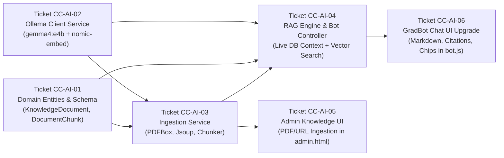

# 🎟️ Vertical-Slice Implementation Tickets: AI Chatbot & RAG Engine

This document details the vertical-slice work tickets to implement the **BVICAM AI Chatbot & RAG Knowledge Engine** with **Ollama (`gemma4:e4b`)**, Admin document ingestion, and live GradLink context.

---

## 📋 Ticket Dependency Graph



---

## Ticket CC-AI-01: Domain Model & Database Schema for Knowledge Base

- **Type:** Feature / Database
- **Estimated Effort:** 2 Hours
- **Status:** DONE

### Description
Create the relational domain models and Spring Data JPA repositories to store uploaded notices, scraped BVICAM web pages, and their associated chunk embeddings.

### Files to Create / Modify
- Create `src/main/java/com/bvicam/campusconnect/entity/KnowledgeDocument.java`
- Create `src/main/java/com/bvicam/campusconnect/entity/DocumentChunk.java`
- Create `src/main/java/com/bvicam/campusconnect/entity/DocumentCategory.java` (`NOTICE`, `SYLLABUS`, `BVICAM_WEB`, `GENERAL`)
- Create `src/main/java/com/bvicam/campusconnect/entity/SourceType.java` (`FILE_UPLOAD`, `WEB_URL`, `MANUAL_TEXT`)
- Create `src/main/java/com/bvicam/campusconnect/repository/KnowledgeDocumentRepository.java`
- Create `src/main/java/com/bvicam/campusconnect/repository/DocumentChunkRepository.java`
- Update `docs/database-schema.md` with ERD and table specifications.

### Acceptance Criteria
- [x] `KnowledgeDocument` entity contains `id`, `title`, `category`, `sourceType`, `sourceUrl`, `originalFileName`, `chunkCount`, `uploadedBy` (`User` FK), and timestamps.
- [x] `DocumentChunk` contains `id`, `document` (FK with cascading delete), `chunkIndex`, `chunkText` (`@Lob` / `TEXT`), and `embeddingJson` (`@Lob` / `LONGTEXT`).
- [x] Repositories support finding chunks by document ID and calculating cosine similarity against a query embedding.

---

## Ticket CC-AI-02: Ollama LLM & Embedding Client Service

- **Type:** Feature / Backend Service
- **Estimated Effort:** 2.5 Hours
- **Status:** DONE
- **Prerequisite:** Ticket CC-AI-01

### Description
Implement a robust Spring Boot service `OllamaClientService` that communicates with the local Ollama daemon (`http://localhost:11434`) to perform text generation via `gemma4:e4b` and generate embeddings via `nomic-embed-text` (or `all-minilm`).

### Files to Create / Modify
- Create `src/main/java/com/bvicam/campusconnect/service/OllamaClientService.java`
- Create `src/main/java/com/bvicam/campusconnect/dto/OllamaChatRequest.java` & `OllamaChatResponse.java`
- Create `src/main/java/com/bvicam/campusconnect/dto/OllamaEmbeddingResponse.java`
- Update `src/main/resources/application.properties` with configurable Ollama parameters.

### Acceptance Criteria
- [x] Parameterized settings in `application.properties`:
  ```properties
  ollama.base-url=http://localhost:11434
  ollama.chat-model=gemma4:e4b
  ollama.embedding-model=nomic-embed-text
  ollama.timeout-seconds=60
  ```
- [x] `generateChatResponse(systemPrompt, userQuery)` returns text generated by `gemma4:e4b`.
- [x] `generateEmbedding(text)` returns a `List<Double>` vector.
- [x] Resilient error handling: if Ollama is unreachable or times out, returns a clean fallback response rather than crashing the application.

---

## Ticket CC-AI-03: Web Scraping & Document Ingestion Pipeline

- **Type:** Feature / Backend Service
- **Estimated Effort:** 3 Hours
- **Status:** DONE
- **Prerequisites:** Ticket CC-AI-01, Ticket CC-AI-02

### Description
Add `Jsoup` and `Apache PDFBox` dependencies to `pom.xml`, and build `KnowledgeIngestionService` to extract clean text from BVICAM website URLs, uploaded PDF notices, and raw text announcements, chunk the content, compute vector embeddings, and persist them.

### Files to Create / Modify
- Update `pom.xml` (add `org.jsoup:jsoup:1.17.2` and `org.apache.pdfbox:pdfbox:3.0.1`)
- Create `src/main/java/com/bvicam/campusconnect/service/KnowledgeIngestionService.java`
- Create `src/main/java/com/bvicam/campusconnect/util/TextChunker.java`

### Acceptance Criteria
- [x] PDF text extraction handles multi-page documents and strips extraneous whitespace.
- [x] BVICAM web scraping strips navigation menus, footer scripts, and CSS, isolating page article/body text.
- [x] `TextChunker` recursively splits content into ~600-character segments with ~100-character overlap.
- [x] Automatically saves document record and all embedded chunks in a single transactional pipeline.

---

## Ticket CC-AI-04: RAG Retrieval & Hybrid Context Synthesis Engine

- **Type:** Feature / Backend Service & Controller
- **Estimated Effort:** 3.5 Hours
- **Status:** DONE
- **Prerequisites:** Ticket CC-AI-01, Ticket CC-AI-02, Ticket CC-AI-03

### Description
Implement `CampusAiService` and upgrade `BotController` to synthesize answers using:
1. Vector similarity search across `DocumentChunkRepository` (Admin notices, BVICAM website).
2. Dynamic structured context from `EventRepository`, `JobRepository`, and `UserRepository`.
3. System prompt instructing `gemma4:e4b` on persona, tone, and citation format.

### Files to Create / Modify
- Create `src/main/java/com/bvicam/campusconnect/service/CampusAiService.java`
- Update `src/main/java/com/bvicam/campusconnect/controller/BotController.java`
- Create `src/main/java/com/bvicam/campusconnect/dto/BotAskRequest.java` & `BotAskResponse.java`

### Acceptance Criteria
- [x] Cosine similarity algorithm ranks top matching chunks (top-K = 4).
- [x] Real-time queries for upcoming events, new jobs, or batch directories are fetched dynamically from live JPA repositories.
- [x] Synthesizes clean Markdown replies with source citations (e.g. `[Source: Notice - Midterm Dates]`).
- [x] All authenticated roles (`STUDENT`, `ALUMNI`, `ADMIN`) can call `POST /api/bot/ask`.

---

## Ticket CC-AI-05: Admin Knowledge & Document Management

- **Type:** Feature / Admin Controller & Frontend UI
- **Estimated Effort:** 3 Hours
- **Status:** DONE
- **Prerequisites:** Ticket CC-AI-03, Ticket CC-AI-04

### Description
Expose Admin REST endpoints under `/api/admin/knowledge/**` (secured with `hasRole('ADMIN')`) and add a dedicated "AI Knowledge & Notices" sub-tab in `admin.html` with file upload, URL scraper, and document management table.

### Files to Create / Modify
- Create `src/main/java/com/bvicam/campusconnect/controller/AdminKnowledgeController.java`
- Update `src/main/resources/static/components/admin.html` (add `#admin-knowledge` tab pane)
- Update `src/main/resources/static/js/modules/admin.js` (add document upload, URL scrape, and table handlers)

### Acceptance Criteria
- [x] Admin can upload a PDF or text file notice.
- [x] Admin can submit a BVICAM URL (e.g. `https://bvicam.in/admissions`) to crawl and index.
- [x] Admin can view all indexed documents with title, category, chunk count, date, and delete action.
- [x] Deleting a document removes its chunks and embeddings immediately.

---

## Ticket CC-AI-06: GradBot Chatbot UI Upgrade

- **Type:** Feature / Frontend UI
- **Estimated Effort:** 2 Hours
- **Status:** DONE
- **Prerequisites:** Ticket CC-AI-04

### Description
Upgrade `#botWindow` floating assistant in `dashboard.html` and `bot.js` to render Markdown formatted responses, display source citation badges, and offer dynamic quick-prompt suggestions.

### Files to Create / Modify
- Update `src/main/resources/static/js/modules/bot.js`
- Update `src/main/resources/static/dashboard.html`
- Update `src/main/resources/static/css/components.css`

### Acceptance Criteria
- [x] Renders formatted markdown (bullet points, bold text, code blocks) cleanly.
- [x] Displays citation tags (e.g. `[BVICAM Website]`, `[Notice: Exam Dates]`).
- [x] Shows quick prompt chips for common BVICAM queries (Admissions, Placements, Events, Syllabi).
- [x] Retains conversation history while the user navigates across different dashboard tabs.
